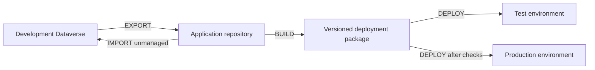

# ALM4Dataverse

Source-controlled application lifecycle management for Microsoft Dataverse, using
**Azure DevOps** or **GitHub Actions (PREVIEW)**. Export maker changes, build a numbered
deployment package, and promote that same package through your environments.

This repository contains the shared PowerShell automation, pipeline and action
templates, setup scripts, and the guides for operating and extending them. Basic
Dataverse solution knowledge is assumed.

## How It Works

| Operation | Purpose | Result |
| --- | --- | --- |
| [EXPORT](docs/usage/exporting-changes.md) | Capture development changes | Unpacked solution source, version updates, optional data, and a pushed commit. |
| [BUILD](docs/usage/building-releases.md) | Package a selected source commit | Managed/unmanaged packages, configured assets, deployment scripts, and a dependency lock; optional checker and deployment validation. |
| [DEPLOY](docs/usage/deploying.md) | Promote an existing successful build | Target settings applied during import, process ownership/activation, hooks, and deployment history. No rebuild. |
| [IMPORT](docs/usage/importing-changes.md) | Synchronize a development environment | A build from source deployed unmanaged, including normal build/deployment hooks. |

Each application gets its own repository holding solution source, configuration, data
and small caller files; the shared automation stays here or in your fork. See the
[application repository layout](docs/concepts/application-repository.md) and the
[glossary](docs/concepts/glossary.md).

## Getting Started

Pick a platform and follow its quickstart: it takes you from nothing to a first test
deployment using automated setup.

- [Quickstart: GitHub Actions](docs/getting-started/quickstart-github.md)
- [Quickstart: Azure DevOps](docs/getting-started/quickstart-azdo.md)

Not sure which platform? Read
[Should I use Azure DevOps or GitHub?](docs/faqs.md#should-i-use-azure-devops-or-github)

> [!IMPORTANT]
> ALM4Dataverse doesn't create environments, test your application, or guarantee
> rollback. Read [responsibilities and limits](docs/concepts/responsibilities.md) before
> production depends on it.

## Features

- Zero, one, or multiple solutions per application, ordered by dependency; managed deployment by default with per-solution unmanaged options.
- Version-aware solution installation, updates, and upgrades, plus connection references, Dataverse environment values, and process ownership/activation.
- PowerShell hooks for configuration data, schema migrations, organization settings, and other build/export/deployment tasks.
- Pinned module/PAC dependencies, cache-aware installation, and a per-build dependency lock.
- Optional PAC Solution Checker and deployment validation, including a retained release or last-deployed environment baseline.
- Branch-specific development and deployment workflows, with platform-specific approval, permission, and concurrency controls.

## Documentation

### Set Up

| Platform | Guides |
| --- | --- |
| GitHub Actions | [Quickstart](docs/getting-started/quickstart-github.md), [full setup](docs/setup/github-setup.md), [environment checklist](docs/setup/github-variables.md) |
| Azure DevOps | [Quickstart](docs/getting-started/quickstart-azdo.md), [requirements](docs/setup/azdo-organisation-requirements.md), [automated setup](docs/setup/azdo-automated-setup.md), [manual setup](docs/setup/azdo-manual-setup.md) |

### Use It Day To Day

- [Branching strategies](docs/usage/branching-strategies.md): choose development and promotion branches.
- [Exporting changes](docs/usage/exporting-changes.md): capture maker changes and understand version increments.
- [Building releases](docs/usage/building-releases.md): artifacts, checker reports, deployment validation, and GitHub Release cleanup.
- [Deploying](docs/usage/deploying.md): select builds, promote, retry, redeploy, and plan recovery.
- [Importing changes](docs/usage/importing-changes.md): synchronize development from source.
- [Troubleshooting](docs/usage/troubleshooting.md): diagnose authentication, triggers, packaging, imports, and missing artifacts.

### Extend And Customize

- [Writing hooks](docs/usage/writing-hooks.md): run your own PowerShell during export, build and deployment.
- [Data import and export example](docs/config/example-hooks/data-import-export.md): move configuration records between environments.
- [Adding solutions, plug-ins, web resources, and Code Apps](docs/usage/adding-dataverse-components.md): build components from source into solutions.
- [Updating and customizing](docs/usage/updating.md): shared-code upgrades, forks, re-running setup, and credential rotation.
- [Upgrade notes](docs/usage/upgrade-notes.md): changes that need action when you move to a newer shared ref.

### Reference

- [ALM configuration](docs/config/alm-config.md): every application/default setting, merge behavior, hook context, checker, and timeout.
- [Pipelines, actions, and scripts](docs/config/pipelines.md): inputs, outputs, parameters, permissions, and direct PowerShell usage.
- [Git tag catalog](docs/config/git-tags.md): solution reservations, build identities, deployment pointers, gates, and cleanup metadata.
- [GitHub variables and secrets](docs/config/github-secrets.md): credentials, prefixes, secret selection, and OIDC.
- [Azure DevOps variable groups](docs/config/azdo-environment-variable-group.md): process owner, target values, and secrets.
- [Azure DevOps service connections](docs/config/azdo-environment-service-connection.md): authentication and authorization.
- [Frequently asked questions](docs/faqs.md)

### AI Agents

Application repositories created by setup include an
[`AGENTS.md`](copy-to-your-repo/AGENTS.md) that tells coding agents which shared
framework is in use, which files they may change, and where the guides for the pinned
version live. Ask an agent to read it before it changes Dataverse components or ALM
configuration. Agents working on this repository should start with the root
[`AGENTS.md`](AGENTS.md).

## Contributing And Support

- [Contributing](CONTRIBUTING.md): how to propose changes, run checks, and write documentation.
- [Security policy](SECURITY.md): how to report a vulnerability privately.
- [Maintainer guide](docs/maintainers.md): source map, tests, dependency updates, and shared releases.
- [PowerShell development](docs/development/powershell.md): local checks, analyzer policy, and coverage.
- [Maintainer scripts and checks](.github/scripts/README.md)
