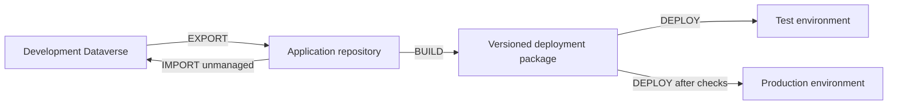

# ALM4Dataverse

Source-controlled application lifecycle management for Microsoft Dataverse, using
**Azure DevOps** or **GitHub Actions (PREVIEW)**. Export maker changes, build a numbered
deployment package, and promote that same package through your environments.

This repository contains shared PowerShell automation, pipeline/action templates,
setup tools, and the guides for operating and extending them. Basic Dataverse solution
knowledge is assumed; start below for the repository and pipeline workflow.

## How It Works

| Operation | Purpose | Result |
| --- | --- | --- |
| [EXPORT](docs/usage/exporting-changes.md) | Capture development changes | Unpacked solution source, version updates, optional data, and a pushed commit. |
| [BUILD](docs/usage/building-releases.md) | Package a selected source commit | Managed/unmanaged packages, configured assets, deployment scripts, and a dependency lock; optional checker and deployment validation. |
| [DEPLOY](docs/usage/deploying.md) | Promote an existing successful build | Target settings applied during import, process ownership/activation, hooks, and deployment history. No rebuild. |
| [IMPORT](docs/usage/importing-changes.md) | Synchronize a development environment | A build from source deployed unmanaged, including normal build/deployment hooks. |

Your application repository owns solution source, configuration, data, and small caller
files. Shared automation stays in this repository or your fork. Azure DevOps setup
imports a shared repository into your project; GitHub callers can reference public
actions directly. Each build snapshots its deployment code, while target credentials
and environment-specific values are supplied at runtime.

## Features And Boundaries

- Zero, one, or multiple solutions per application, ordered by dependency; managed deployment by default with per-solution unmanaged options.
- Version-aware solution installation, updates, and upgrades, plus connection references, Dataverse environment values, and process ownership/activation.
- PowerShell hooks for configuration data, schema migrations, organization settings, and other build/export/deployment tasks.
- Pinned module/PAC dependencies, cache-aware installation, and a per-build dependency lock.
- Optional PAC Solution Checker and deployment validation, including a retained release or last-deployed environment baseline.
- Branch-specific development and deployment workflows, with platform-specific approval, permission, and concurrency controls.
- Branch-suffixed GitHub BUILD releases, deployment pointers, and branch-aware Release cleanup.

> [!IMPORTANT]
> ALM4Dataverse does not provision Dataverse environments, replace functional testing,
> or guarantee rollback of solution/data changes. An artifact snapshots deployment
> content, not the hosted runner or target state. Plan backups, access controls, retention,
> and recovery alongside automation. GitHub plan/visibility restrictions also apply;
> manual gate tags are not an independent reviewer approval system.

## Getting Started

Choose one platform, review its prerequisites, and run setup using a reviewed release
script or follow the manual steps. Not sure which platform to choose? Read
[Should I use Azure DevOps or GitHub?](docs/faqs.md#should-i-use-azure-devops-or-github)
for a comparison of free limits, paid costs, and deployment approvals.

> [!TIP]
> Start with non-production targets and decide on a
> [branching strategy](docs/usage/branching-strategies.md) before naming environments.

### GitHub Actions

Follow [GitHub setup](docs/setup/github-setup.md) for automated or manual installation,
then complete the [environment checklist](docs/setup/github-variables.md). Check
[plan limitations](docs/setup/github-setup.md#github-licence-limitations) before choosing
authentication storage and promotion controls. GitHub support is in preview.

### Azure DevOps

Check [organization requirements](docs/setup/azdo-organisation-requirements.md), then
use [automated setup](docs/setup/azdo-automated-setup.md) or the
[manual setup guide](docs/setup/azdo-manual-setup.md). Arrange hosted-agent capacity,
extensions, service connections, target settings, and pipeline resource permissions.

### First Successful Run

1. List solution unique names in dependency order and configure required assets/hooks.
2. Verify the selected development target, application identity, process-owner user, connections, and environment-specific values.
3. Run EXPORT and inspect its commit. Check the resulting BUILD, or start BUILD manually if no new commit was needed.
4. Deploy that exact successful build to the first non-production target and verify application behavior.
5. Promote the same build through later targets. Configure branch/PR policies separately if validation is required before merge.

## Documentation

### Initial Setup

| Platform | Guides |
| --- | --- |
| GitHub Actions | [Setup](docs/setup/github-setup.md), [environment checklist](docs/setup/github-variables.md) |
| Azure DevOps | [Requirements](docs/setup/azdo-organisation-requirements.md), [automated setup](docs/setup/azdo-automated-setup.md), [manual setup](docs/setup/azdo-manual-setup.md) |

### Usage Instructions

- [Branching strategies](docs/usage/branching-strategies.md): choose development and promotion branches.
- [Exporting changes](docs/usage/exporting-changes.md): capture maker changes and understand version increments.
- [Building releases](docs/usage/building-releases.md): artifacts, checker reports, deployment validation, and retention.
- [Deploying](docs/usage/deploying.md): select builds, promote, retry, redeploy, and plan recovery.
- [Cleaning up GitHub Releases](docs/usage/building-releases.md#github-release-cleanup): retention and active-deployment protection.
- [Importing changes](docs/usage/importing-changes.md): synchronize development from source.
- [Troubleshooting](docs/usage/troubleshooting.md): diagnose authentication, triggers, packaging, imports, and missing artifacts.
- [Updating and customizing](docs/usage/updating.md): shared-code upgrades, forks, credential rotation, and extension choices.

### Configuration Reference

- [ALM configuration](docs/config/alm-config.md): every application/default setting, merge behavior, hook context, checker, and timeout.
- [Pipelines, actions, and scripts](docs/config/pipelines.md): inputs, outputs, parameters, permissions, and direct PowerShell usage.
- [GitHub variables and secrets](docs/config/github-secrets.md): canonical credential, prefix, secret-selection, and OIDC reference.
- [Azure DevOps variable groups](docs/config/azdo-environment-variable-group.md): process owner and target values.
- [Azure DevOps service connections](docs/config/azdo-environment-service-connection.md): authentication and authorization.

### Example 'Hook' Extensions

- [Data import and export](docs/config/example-hooks/data-import-export.md): configuration records, relationships, and deletion handling.
- [Organization settings](docs/config/example-hooks/organization-settings.md): target configuration through deployment hooks.

### Further Reading

- [Frequently asked questions](docs/faqs.md)
- [Maintainer guide](docs/maintainers.md): tests, dependency updates, and shared releases.
- [Maintainer scripts and checks](.github/scripts/README.md)

## Contributing

See [PowerShell Development](docs/development/powershell.md) for local checks,
regression tests, analyzer policy, and the PowerShell CI workflow.
