# Azure DevOps Automated Setup

> [!TIP]
> Need to configure resources individually? Follow the [manual setup guide](azdo-manual-setup.md).

Setup provisions ALM resources interactively: repositories, caller pipelines, service
connections, variable groups, and target configuration. It does not create your Dataverse
environments or replace a backup/recovery plan. Run it with a setup identity authorized
to make these changes; pipeline execution later uses the configured application identities.

## Limitations

- The account you use for setup must be in the same Entra ID tenant as:

  - the Dataverse environments for development and deployment
  - the Azure DevOps organisation.

- The process works for the standard `Azure Cloud` (`Commercial`) cloud and not `GCC` etc.

- Generated pipelines use Microsoft-hosted `windows-2022` agents. Self-hosted pools require manual template customization and validation; they are not a setup-script option.

- Entra ID Applications:
  - if created automatically, will have name in format `<project name> - <env name> deployment` (but you can safely rename them if you wish after creation).
  - you will be prompted to choose between two authentication types:
    - **Service Principal with Secret (traditional)**: Uses a client secret that expires and needs periodic renewal
    - **Workload Identity Federation (recommended)**: Uses OpenID Connect federation with no secrets to manage

## Pre-requisites

Before you start, you need:

- Windows PowerShell 5.1 or PowerShell 7 on Windows, or PowerShell 7 on Linux with Git installed and available on `PATH`. All platforms need network access to the required Microsoft services, GitHub, and package feeds.
- Existing Dataverse environments, the solutions to manage, and suitable process-owner user accounts.
- Permission to create/configure Entra apps, Dataverse application users, and the relevant Azure DevOps resources, or administrators available to complete those steps.

Windows setup downloads temporary portable Git; Linux setup uses system Git from `PATH`.
Setup also downloads its required PowerShell modules. Keep interactive authentication in
the console/browser; do not put passwords or tokens into source files or command history.

### 1) An Azure DevOps organisation

You will need an Azure DevOps organisation with pipeline capabilities enabled. See [Azure DevOps Organisation Requirements](azdo-organisation-requirements.md) for details on:

- Creating a new organisation if you don't have one
- Configuring pipeline capabilities (free or paid options)
  
### 2) An Azure DevOps project or permissions to create one

You will need to be 'Project Collection Administrator' if you want the automated process to create a new project for you. Otherwise, you will need a project with 'Project Administrator' role assigned to you.
  
[How to create a new project](https://learn.microsoft.com/en-us/azure/devops/organizations/projects/create-project?view=azure-devops&tabs=browser#create-a-project)

> [!TIP]
> Choose a long-lived project name. Avoid phase names such as "CRM System Phase 1".

[How to assign the project administrator role for an existing project](https://learn.microsoft.com/en-us/azure/devops/user-guide/project-admin-tutorial?toc=%2Fazure%2Fdevops%2Forganizations%2Ftoc.json&view=azure-devops#add-members-to-the-project-administrators-group)

### 3) Entra ID Applications for each environment

> [!TIP]
> Use a separate application for each environment (or at least one for non-production and one for production) to keep proper separation between environments.
> There is no cost to these applications, so there is no significant overhead in doing this.

## Running Setup

Download and review the released script before executing it:

```powershell
Invoke-WebRequest 'https://github.com/ALM4Dataverse/ALM4Dataverse/releases/latest/download/setup-azdo.ps1' -OutFile './setup-azdo.ps1'
```

After review, run `.\setup-azdo.ps1`. To select a tenant or shared code ref, use the
[setup parameters](../config/pipelines.md#setup-script-parameters).

> [!NOTE]
> **Advanced: running source scripts.** Released setup scripts embed their helpers and
> pinned dependencies. A single raw script downloaded from the source repository is not
> equivalent; it needs the adjacent shared files.

The one-line bootstrap is also available after you have reviewed and trust the release:

1) Open Windows PowerShell or PowerShell 7. On Linux, start a `pwsh` terminal.

2) Paste this in and press Enter.

   ```powershell
   iwr https://github.com/ALM4Dataverse/ALM4Dataverse/releases/latest/download/setup-azdo.ps1 | iex
   ```

   Use the download-and-review approach above before trusting this bootstrap.

3) Follow the on-screen instructions.

## What Setup Does

Interactive setup first asks whether to set up a new application repository or
configure an existing one. This choice appears before authentication. New-repository
setup shows authentication, organization selection, and project/repository selection
as ordered prerequisite steps. Existing-repository setup performs those steps before
the guided setup menu and requires an existing project and application repository. In
that menu, the prerequisite rows are marked complete and locked.

After resource selection, normal setup checks that the required Power Platform Azure
DevOps extension is installed and asks whether to use the ALM4Dataverse extension task
for connection-variable resolution. If disabled, only service-principal secret
authentication is available. Pipeline execution still uses the pinned `pacCliVersion`
installed by `installdependencies.ps1` (the templates keep PPBT `AddToolsToPath`
disabled). Normal setup can select or create the shared ALM4Dataverse repository.
`-ApplyConfig` skips the setup-type choice, project/repository creation, extension
installation and shared-repository updates; it selects existing resources and reads
the shared repository/ref from committed config.

### Guided setup menu

The menu seeds existing-repository choices from `alm-config.psd1`; it does not read
pipeline files or pipeline definitions to discover setup settings. If the config has
no branch map, the editor starts with the repository's default branch and empty
environment mappings. The authentication, organization, and project/repository
prerequisites appear at the top as complete and locked. They cannot be repeated from
the guided setup menu.

For a new application repository, only **Configure branches** is available until it
has been completed; later steps unlock in order. Existing repositories can select any
configuration step immediately. They are initialized from saved branch settings and
skip the branch-strategy prompt. Re-running an editable step marks later steps
incomplete until they are revisited. **Apply changes** is the final menu item and only
runs after every editable setup step is complete.

Each menu row includes a short summary of its current selection: branch rows list DEV,
deployment, and BUILD-validation targets; the solution row lists selected solution
names; publication-plan rows when applying a config file list each target's direct or
pull-request mode; and prerequisite rows show the selected project, repositories,
organization, or authentication status. These summaries describe configuration, while
the progress markers describe completion in the current run. Every prompt and menu
shows a setup header for its active section (or prompt title) and keeps one guidance
panel visible; prompts without task-specific guidance show concise input or navigation
help.

When a help page is available, the panel and status bar show **F1 for help**. Press
F1 while a prompt or menu is active to open the current step's page in the default
browser; setup then resumes at the same prompt. The page is selected for the prompt,
step, or Azure DevOps setup flow, and its URL uses the ALM4Dataverse ref selected by
the running setup script.

Before authentication, **Esc** on the setup-type choice cancels setup. In new-repository
setup, **Esc** inside a prerequisite prompt returns to the prerequisite menu, and
**Esc** on that menu cancels. In existing-repository setup, **Esc** in a later
prerequisite returns to the preceding prerequisite; **Esc** at the first one cancels.
Inside branch configuration, **Esc** returns to the guided setup menu. **Esc** on the
main menu cancels setup.

The screenshots below are actual terminal output from the setup display helpers used by
the released setup scripts. They were captured with a local sample environment catalog
and reserved example values such as `example-org` and `example.com`; no Azure DevOps,
Dataverse, or tenant resources were accessed. The preview generators are the same ones
used by Apply. Prompt text is shown as it appears in setup; environment and provider-side
choices depend on the signed-in account.

#### Setup menu examples

Both menus show the authentication and resource-selection prerequisites as complete
and locked. For a new repository, only **Configure branches** is initially available;
for an existing repository, the configuration steps are available and the branch
editor starts from saved mappings. The progress markers show completion in the current
run, not whether configuration is saved.

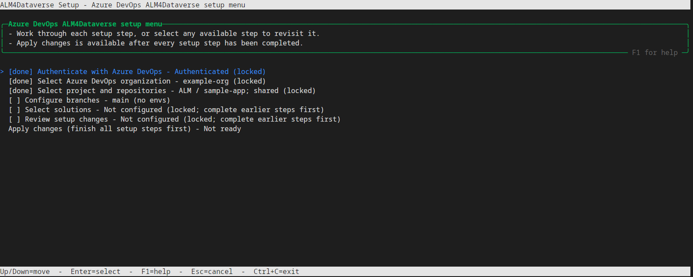

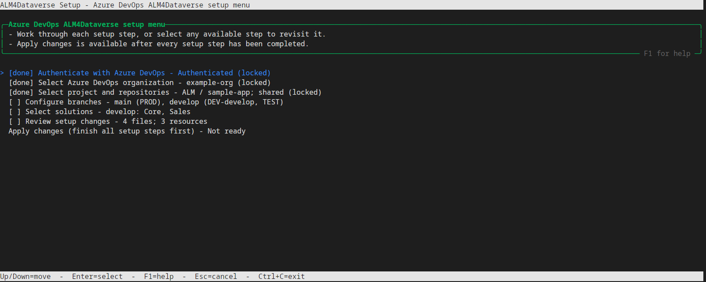

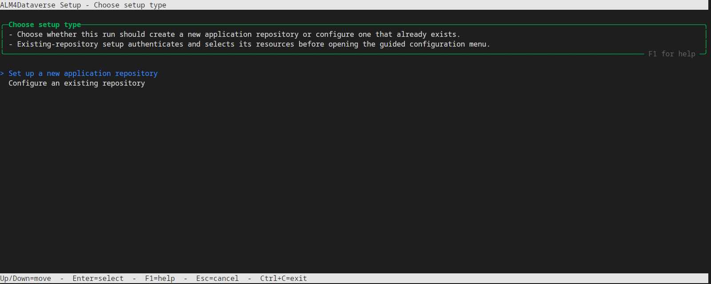

#### Step 1 — Configure branches

The branch editor is where you define branch names and configure DEV environments,
deployment targets, and BUILD validation separately for each branch. These settings
are all part of **Configure branches**; there are no separate DEV, deployment, or BUILD
validation menu items.

1. **Choose a branch strategy for a new repository.** Select `main only` or
   `main + develop`. This creates the starting branch mappings; it does not configure
   branch protection or pull-request policies. Existing repositories go directly to
   the branch table and skip this prompt. Their mappings come from `alm-config.psd1`;
   if it has no branch mappings, setup starts with the repository's default branch.

   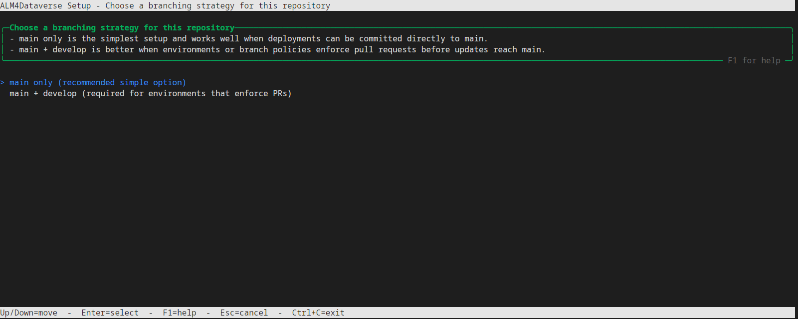

2. **Add or edit branch mappings.** The strategy supplies the initial `main` and,
   optionally, `develop` mappings. To add another branch, choose **Add a branch
   mapping** and enter its branch name. To change an existing branch, choose **Edit a
   branch mapping** and select it. Branch names must be unique.

   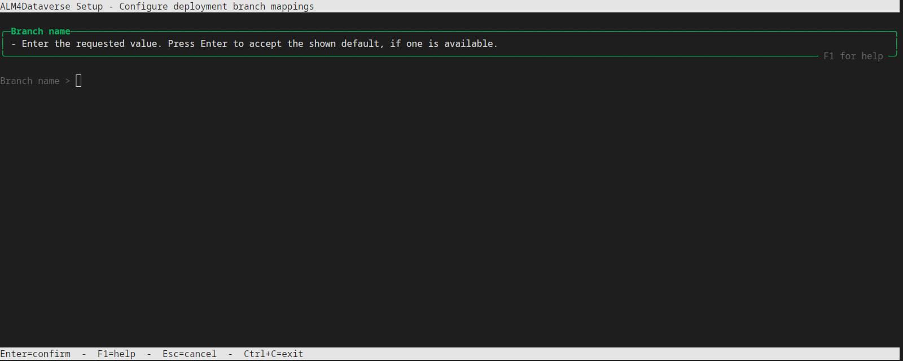

3. **Choose whether each branch has a DEV environment.** For a new, unconfigured
   Azure DevOps branch, the confirmation defaults to **Yes**. Choose **Yes** to select
   a Dataverse environment; setup assigns it the name `Dev-<branch>`. The name is
   generated from the branch and is not entered separately. Choose **No** when the
   branch has no DEV environment; that branch cannot be selected later as the source
   for discovering solutions. Existing DEV mappings are loaded into the editor and can
   be retained or changed.

   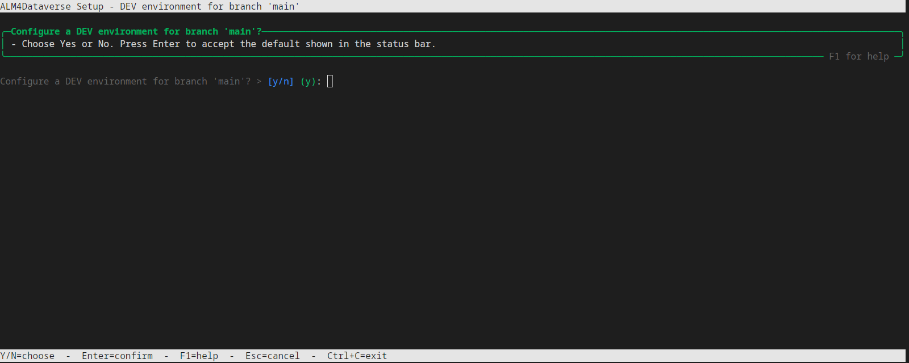

   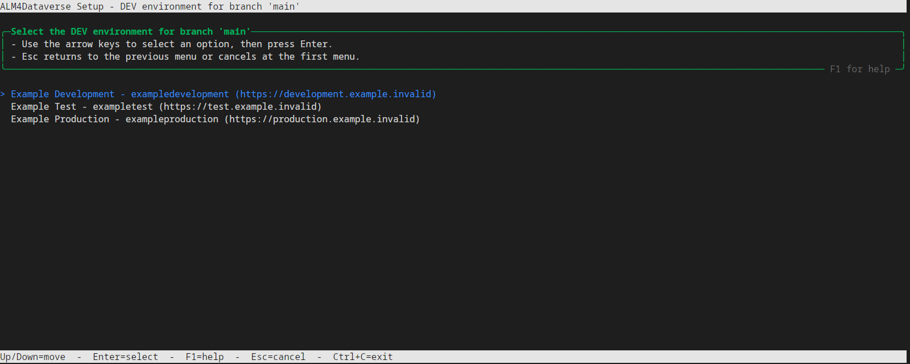

4. **Choose credentials and the process-owner account.** Setup asks for service-principal
   credentials and a service-account UPN after you select a DEV, deployment, or BUILD
   validation environment. Depending on what is already configured or selected in this
   setup run, the menus offer creating a service connection, entering existing
   connection details, or reusing an available credential. When the required Azure
   DevOps extension is enabled, a new credential can use workload identity federation
   or a client secret; without the extension, setup offers secret-based authentication
   only. The service-account menu similarly lets you enter or reuse an account.

   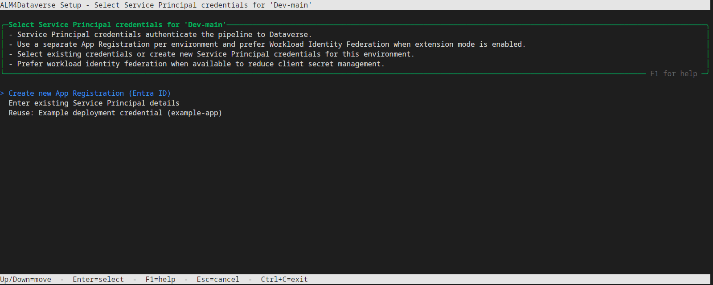

   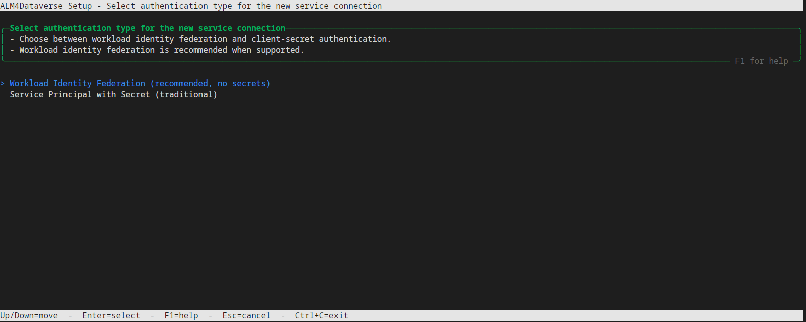

   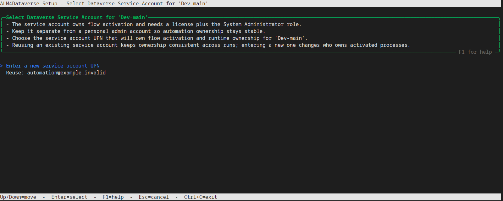

   The service account is a licensed user for process ownership, not the application
   identity used to authenticate deployment. A manually entered UPN is format-checked;
   setup does not verify its licensing or Dataverse roles. Keep client secrets out of
   `alm-config.psd1` and source control.

5. **Add deployment targets for the branch.** Choose **Add an environment**, select a
   Dataverse environment, then enter its short name (for example, `TEST`, `UAT`, or
   `PROD`). The branch's DEV environment is excluded from the deployment choices.
   Repeat for each target, selecting credentials and a service account for each one;
   previously selected credentials and accounts may be offered for reuse. Choose
   **Done** when the list is complete. A branch may have no deployment targets.

   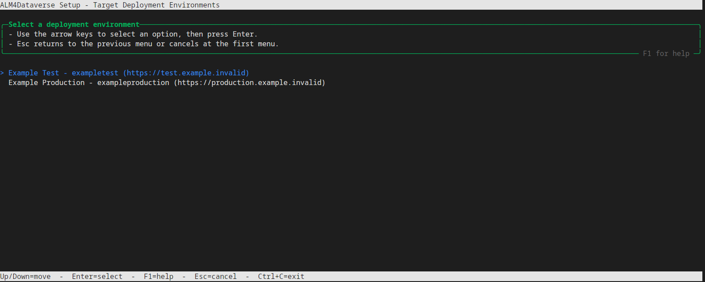

   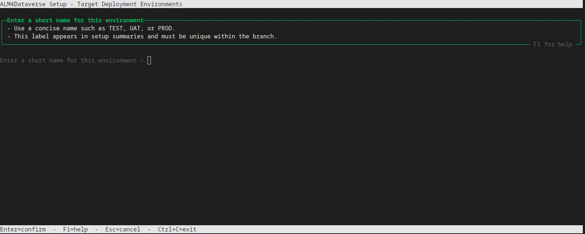

   Add deployment targets in promotion order: the list order becomes the generated
   deployment-stage order. There is no move action, so remove and re-add an environment
   to change its position. The plan below shows the URL, credential type, and service
   account for each selected target.

   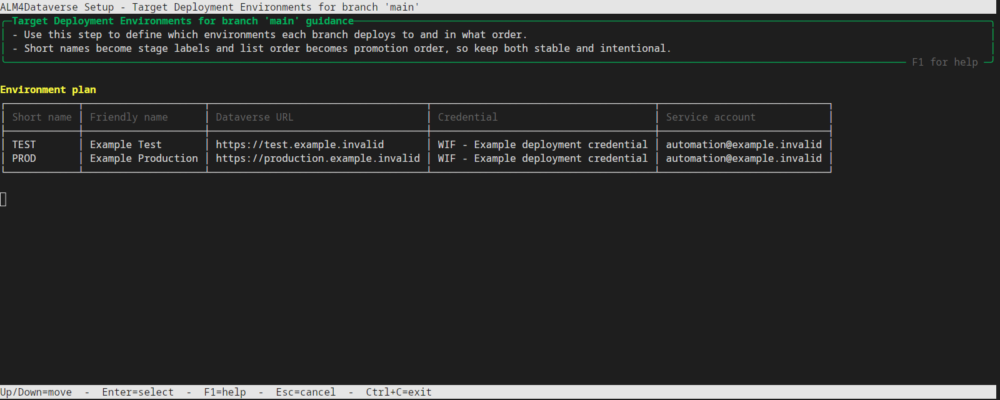

6. **Configure BUILD validation for each branch.** Choose whether to deploy the
   branch's BUILD artifact to a Dataverse validation environment. If enabled, select
   that environment, set its Azure DevOps service connection name, and optionally
   choose a deployment environment as the baseline source. This is separate from the
   branch's DEV and deployment targets.

   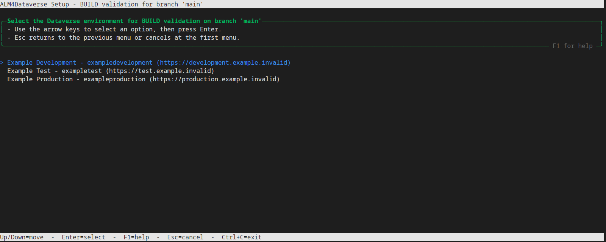

7. **Review the branch map.** After configuring a branch, setup returns to the mapping
   table. Add, edit, or remove mappings until the table shows the intended assignments,
   then choose **Done**. You can reopen a branch to edit its DEV environment, deployment
   targets, or BUILD validation settings. The example shows two branches with separate
   DEV environments and deployment targets.

   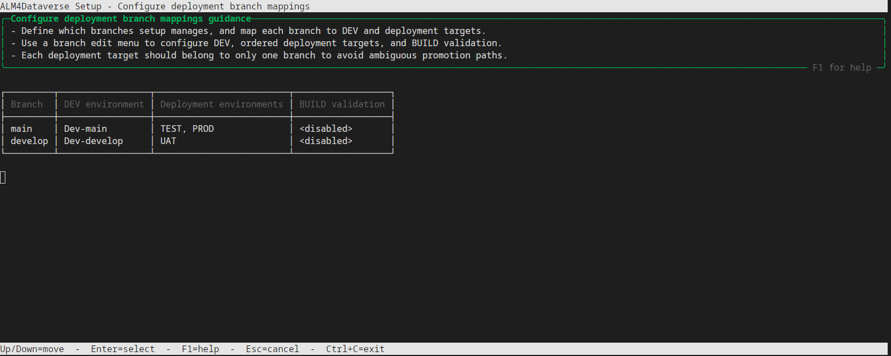

#### Step 2 — Select solutions

Choose a branch with a DEV environment as the solution discovery source, then select
and order the solutions. The selected-solution summary is rendered in dependency order:

```text
Selected solutions (dependency order)
┌───┬───────────────┬─────────────┐
│ # │ Friendly name │ Unique name │
├───┼───────────────┼─────────────┤
│ 1 │ Example Core  │ ExampleCore │
└───┴───────────────┴─────────────┘
```

#### Step 3 — Review setup changes

Review the summary of the complete setup for a new repository or the changes to an
existing repository. It includes the project and repository, branch/environment
mappings, BUILD validation, solution choices, extension mode, and counts of files to
add, modify, or delete. It also lists deferred Azure DevOps, Entra ID, and Dataverse
operations: pipeline definitions and permissions, service connections and federated
credentials, environments, variable groups and checks, and Dataverse application and
service-account users/roles. This is a plan based on the selected setup, not a live
before/after resource diff; an **Ensure** operation may find the resource already in
its desired state. Prerequisites already applied to let setup proceed are excluded,
and secret values are never displayed. Existing service connections are marked for
reuse, existing variable values are not overwritten, and existing approval checks
are retained when no new approval is requested.

The review menu separates the config-only diff from the diff of every repository file
that setup will change:

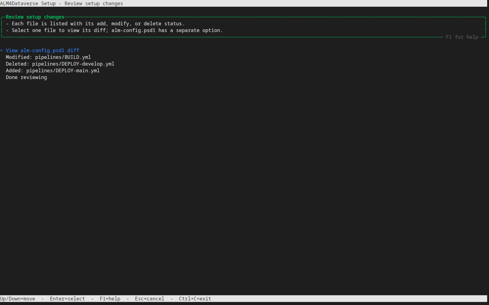

The file list labels each change as added, modified, or deleted. Select
**View alm-config.psd1 diff** for the separate config view, or select a status-labeled
repository file to open its diff. Only one file is shown at a time. The diff is colored
and side by side; scroll with Up/Down or Page Up/Down, jump with Home/End, and press Q
or Esc to return to the file list. These previews are generated in a temporary tree
and leave the selected repository unchanged.

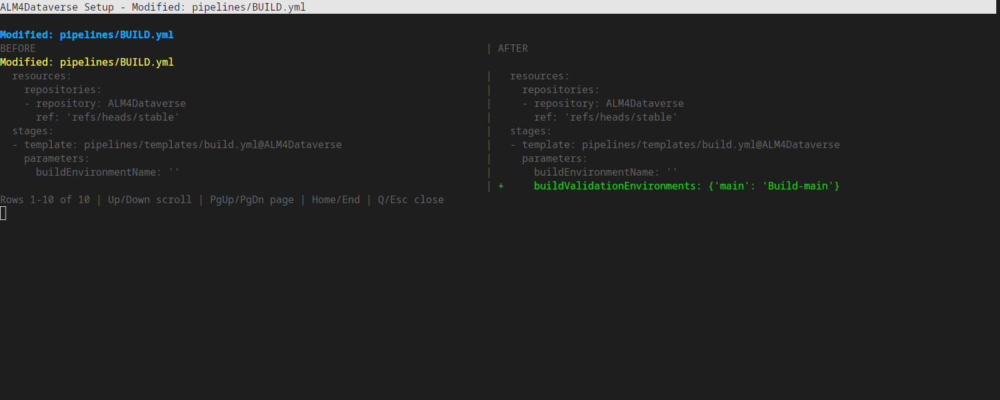

#### Step 4 — Apply changes

**Apply changes** is the final menu item. Before all setup steps are complete, selecting
it reports that the remaining steps must be completed; after that, setup publishes the
generated files according to each branch's publication plan and applies the listed
Azure DevOps, Entra ID, and Dataverse operations. These external changes happen during
setup even if publication creates a pull request; only the repository-file changes wait
for that pull request to merge. The last menu item before completion is:

```text
Apply changes (finish all setup steps first)
```

On success, the completion panel links to the Azure DevOps project. Its example output
is:

```text
╭─Ready to open────────────────────────────────────────────────────────────────╮
│                                                                              │
│ The guided setup has finished and the generated automation assets are ready  │
│ for review.                                                                  │
│ Open your Azure DevOps project:                                              │
│ https://dev.azure.com/example-org/sample-app/_build                          │
│                                                                              │
╰──────────────────────────────────────────────────────────────────────────────╯
```

If Apply fails, the error is displayed and setup returns to the menu with all
selections retained. You can edit a step and select **Apply changes** again; operations
that already succeeded are not rolled back. The retry notice is:

```text
Your setup selections are still available. Edit a step or select Apply changes to retry.
```

### Apply a committed config without editing settings

Use this mode when `alm-config.psd1` has been reviewed and committed to the application
repository's default branch, and you want to regenerate its pipeline files without
running the settings editors:

```powershell
.\setup-azdo.ps1 -ApplyConfig
```

To inspect committed config changes without publishing:

```powershell
.\setup-azdo.ps1 -ApplyConfig -PreviewOnly
```

1. Select an existing Azure DevOps project and application repository. This mode does
   not offer to create either one.

   ```text
   Selected project: sample-app
   Selected main repository: sample-app
   Existing shared repository detected from alm-config.psd1: ALM4Dataverse
   ```

2. Setup reads the shared repository/ref, provider options, and branch mappings from
   the committed config. It does not infer settings from pipeline YAML or registered
   pipeline definitions, and does not install extensions, register pipeline
   definitions, grant permissions, or configure environments.

3. The reduced menu shows the prerequisites as complete and locked, then lets you
   choose publication methods and review the generated changes. The config has a
   separate diff, and each repository file is selectable from the status-labeled
   change list:

   ```text
   Authenticate with Azure DevOps (complete and locked)
   Select Azure DevOps organization (complete and locked)
   Select project and repositories (complete and locked)
   Choose publication methods
   Review setup changes
   Apply changes (finish all setup steps first)
   ```

   `-PreviewOnly` skips the publication-plan step and opens the same status-labeled file
   picker. Select one file to print its complete diff without paging; return to the
   picker to inspect another file, then choose **Done reviewing** to exit. It requires
   `-ApplyConfig` and never modifies or publishes repository files. Its resource section
   reports that no external resources will be modified; this mode does not plan or
   provision Azure DevOps, Entra ID, or Dataverse changes.

4. Select **Apply changes** after reviewing the diff. Setup publishes the generated
   repository files and returns to the menu with selections intact if publication fails.
   The completion panel is the same as [Step 4](#step-4--apply-changes). Missing or
   invalid provider, repository, ref, or branch metadata stops before publication.

> [!NOTE]
> **Advanced: BUILD validation.** Generated pipelines deploy an available baseline first,
> then the candidate, and run configured PAC Solution Checker rules. If the baseline source
> has no successful deployment pointer yet, BUILD warns and validates only the candidate.
> A successful DEPLOY creates the pointer for subsequent builds.
>
> Setup creates no deployment approvers team or approval check for the BUILD variable group.
> Deployment target groups retain their approval checks, and existing checks are left unchanged.
> BUILD validation is configured per branch; branches can use separate environments or
> deliberately share one. Choose a non-production environment that is safe to update
> repeatedly and serialize builds that could update the same environment. See
> [Building Releases](../usage/building-releases.md).

## After Setup

1. Review generated caller files, solution order, environment URLs, authentication type, and the selected shared-code ref.
2. Complete target settings that automation cannot infer: connection IDs, Dataverse values, custom secrets, and hook configuration. See [variable groups](../config/azdo-environment-variable-group.md).
3. Check pipeline resource permissions, approver membership, and locks. Confirm the process-owner UPN identifies the intended enabled Dataverse user.
4. Run [EXPORT](../usage/exporting-changes.md) to establish solution source, then verify [BUILD](../usage/building-releases.md).
5. Deploy that exact build to a non-production target and test the application before promoting it further.
6. Configure branch/PR build policies separately if required; setup does not enforce your review process.

## Reconfigure An Existing Installation

Re-run setup to select existing resources and review its proposed updates.
[Re-running setup](../usage/updating.md#re-run-setup-carefully) lists which files and
settings it keeps and which it replaces.

> [!CAUTION]
> Review custom callers and approval checks in the resulting changes.
> Do not run two setups concurrently against the same repository. If setup fails partway,
> inspect resources already created before retrying; changes are not automatically rolled back.

Keep shared repository updates and application caller changes consistent. An older
release artifact retains its packaged deployment scripts even after shared code is
updated. See [pipeline parameters](../config/pipelines.md) for manual customization.
