# GitHub Actions Setup Guide

GitHub Actions support is **PREVIEW**. This guide covers automated and manual setup.
For Azure DevOps, use the [Azure DevOps setup guide](azdo-automated-setup.md).

The application repository contains unpacked solutions, its ALM configuration, data/hooks,
and small caller workflows. Shared composite actions run the build/export/import/deploy
steps; a separate reusable workflow handles Release cleanup. You do not need a second
GitHub repository unless you want to maintain a fork of the shared implementation.

## Prerequisites

- A GitHub repository with Actions enabled and permission to configure its workflows, variables, secrets, and environments.
- Access to development and deployment Dataverse environments and permission to create/manage application users.
- An Entra app registration for each target, or permission to create one and configure its authentication.
- An existing user account for process ownership, with the necessary licensing, roles, and connection access.
- A GitHub plan supporting the environment features you intend to use; see [licence limitations](#github-licence-limitations).
- For automated setup: Windows PowerShell 5.1 or PowerShell 7 on Windows, Git, and network access to GitHub and the required Microsoft/package services. Setup downloads a temporary GitHub CLI when `gh` is missing.

> [!NOTE]
> **Optional Dev Container.** The repository includes a [Dev Container](../../.devcontainer/devcontainer.json)
> with PowerShell 7, Git, and GitHub CLI. It keeps the setup toolchain in a separate
> container, but is not a security boundary: setup still acts with the permissions of
> authenticated accounts. Use least-privilege identities and do not mount host credential
> files into the container.

> [!CAUTION]
> Use separate application identities for production and non-production. The application
> user authenticates automation; the service-account user owns and activates processes.
> They are not interchangeable. The standard setup assigns the application user the
> Dataverse System Administrator role. Restrict access to CI credentials and treat
> workflow and hook changes as privileged code changes.

## Automated Setup

Download the released script, review it, then run it from PowerShell:

```powershell
Invoke-WebRequest 'https://github.com/ALM4Dataverse/ALM4Dataverse/releases/latest/download/setup-github.ps1' -OutFile './setup-github.ps1'
```

After reviewing the downloaded file:

```powershell
.\setup-github.ps1
```

The existing one-line bootstrap remains available for users who have already reviewed
and trust the release:

```powershell
iwr https://github.com/ALM4Dataverse/ALM4Dataverse/releases/latest/download/setup-github.ps1 | iex
```

Interactive setup first asks whether to set up a new application repository or
configure an existing one. This choice appears before authentication. New-repository
setup runs GitHub/Azure authentication and application-repository selection as ordered
prerequisite steps before opening the guided setup menu. Existing-repository setup does
the same and requires an existing repository. Authentication and application-repository
selection are completed before the menu and do not appear as menu rows. Existing
repository choices include repositories owned by your account, available through an
organization, or shared with you as a collaborator. An existing repository can be empty;
setup creates its initial branch and commit when publishing generated files. When
creating a shared workflow repository, setup prompts for an owner and defaults to the
owner of the selected application repository.

The shared workflow repository appears as a separate, editable menu step. For an existing
repository, setup uses the shared repository and ref from `alm-config.psd1` and marks
selection complete without prompting when that repository is accessible. If the
repository is missing or inaccessible, the selection row remains incomplete and its
summary explains why; select that row to choose an accessible repository. Selecting a
different repository changes the source used by preview and apply but does not check or
update its version. The separate **Check and update shared workflow repository version**
step compares the selected repository with the running ALM4Dataverse ref and offers the
appropriate reconciliation options. Re-running selection marks that later step
incomplete. With `-ApplyConfig`, selection is locked to committed config and the
version-update step is marked as skipped; no shared repository is changed.

### Guided setup menu

The menu seeds existing-repository choices from `alm-config.psd1`; it does not read
workflow files to discover setup settings. If the config has no branch map, the editor
starts with the repository's default branch and empty environment mappings. The
authentication and application-repository prerequisites are completed before this menu
and are not listed. Shared workflow repository selection is the first row; for an
existing repository it is complete only when the configured repository is accessible,
otherwise the incomplete row includes the reason. The version check/update is a separate
row and remains incomplete until selected during normal setup.

For a new application repository, the version check/update follows shared-repository
selection and later steps unlock in order. The shared-repository row remains editable.
Existing repositories can select any configuration step immediately. They are initialized
from saved branch settings and skip the branch-strategy prompt. After each guided step,
setup returns to the menu. Configuration steps are grouped separately from the bold
cyan **Preview changes**, **Apply changes**, and **Exit without applying changes**
actions under a `---` separator. Preview and Apply are marked **Not ready** until every
required setup step is complete; Exit is always available and asks for confirmation.
Preview is optional and does not count toward setup completion. Re-running an editable
step marks later steps incomplete until they are revisited. When ready, the action group
moves first and **Apply changes** is highlighted. Preview is not required before Apply.

Each setup-step row includes a short summary of its current selection: the first shared
workflow repository row shows its repository and ref; the solution row lists selected
solution names; and publication-plan rows when applying a config file list each target's
direct or pull-request mode. The version check/update row shows the upstream
ALM4Dataverse ref. The **Configure branches, dev and deployment envs** row expands into
selectable branch items and nested DEV, deployment, and BUILD-validation environment
items instead of a compact branch summary. Environment rows summarize the Dataverse
friendly name and URL, credential type and name, service-account UPN, and BUILD baseline
when applicable; secret values are never shown. Selecting a branch opens its editor;
selecting an environment opens its detail menu with separate Dataverse, target-name,
credentials, and service-account steps, plus a BUILD-baseline step when applicable.
Completed parts are marked done, and later parts stay locked until earlier steps are
complete. New and existing environments use the same editor. Progress markers describe
completion in the current run. Preview, Apply, and Exit are actions, not progress rows.
An incomplete existing deployment environment keeps branch setup incomplete. A warning
lists each affected branch/environment and its missing details; select its environment
row and finish its detail steps before Preview or Apply becomes available.
Every prompt and menu shows a setup header for its active section (or prompt title) and
keeps one guidance panel visible; prompts without task-specific guidance show concise
input or navigation help.

When a help page is available, the panel and status bar show **F1 for help**. Press
F1 while a prompt or menu is active to open the current step's page in the default
browser; setup then resumes at the same prompt. The page is selected for the prompt,
step, or GitHub setup flow, and its URL uses the ALM4Dataverse ref selected by the
running setup script.

Before authentication, **Esc** on the setup-type choice cancels setup. During ordered
authentication and repository selection, **Esc** in a later prerequisite returns to the
preceding prerequisite; **Esc** at the first one cancels. There is no separate
prerequisite menu. Inside branch configuration, **Esc** returns to the guided setup
menu. **Esc** on the main menu cancels setup without confirmation; **Exit without
applying changes** asks for confirmation first.

The screenshots below are actual terminal output from the setup display helpers used by
the released setup scripts. They were captured with a local sample environment catalog
and reserved example values such as `example-org` and `example.com`; no GitHub,
Dataverse, or tenant resources were accessed. The preview generators are the same ones
used by Apply. Prompt text is shown as it appears in setup; environment and provider-side
choices depend on the signed-in account.

#### Setup menu examples

Authentication and application-repository selection are completed before the menu and
are not listed. The shared-workflow-repository row is always first. For both new and
existing repositories, setup opens this menu after prerequisites and returns to it after
each selected step. New repositories unlock setup steps in order; existing repositories
can select any configuration step and the branch editor starts from saved mappings.
The branch step expands to show each branch and its configured DEV, deployment, and
BUILD-validation environments beneath it. Select a branch to open its editor or an
environment to edit that branch's matching configuration. After each step, the next
incomplete row is highlighted. The bold cyan Preview and
Apply actions are grouped separately from setup steps under a `---` separator, alongside
**Exit without applying changes**. Preview and Apply are marked **Not ready** until all
required setup steps are complete. Preview is optional and does not affect completion;
Apply does not require a preview. Exit is always available and asks for confirmation
before leaving setup without applying the generated changes. The progress markers show
completion in the current run, not whether configuration is saved.

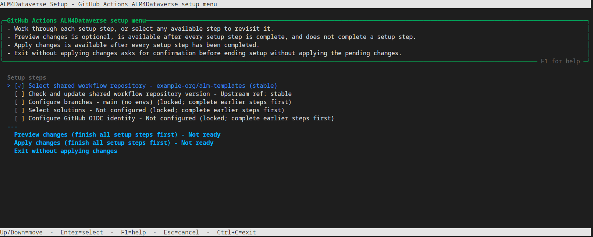

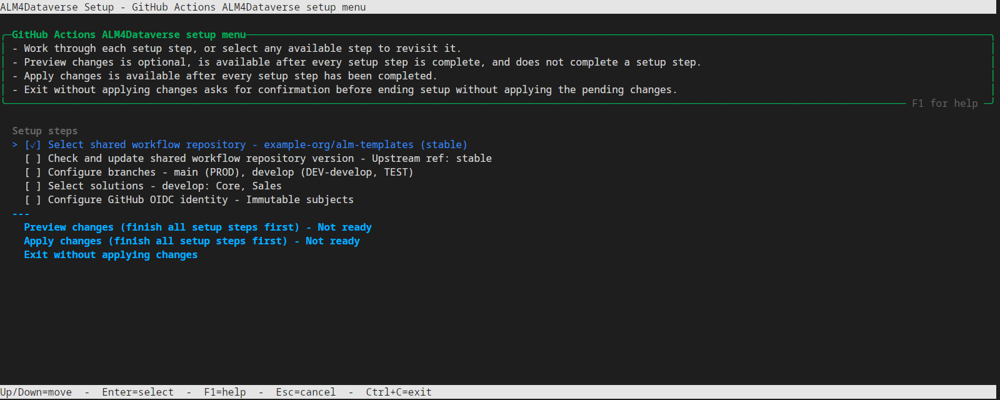

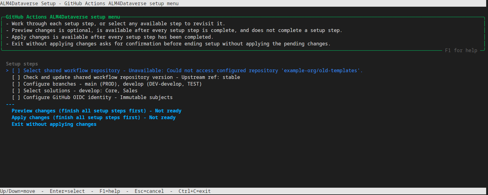

The first screen shows the green Unicode-art product mark beside the ALM4Dataverse
name and version below the setup header. The name and version are on separate lines
with a blank line between them. The version is shown as Development when running
from a source checkout.

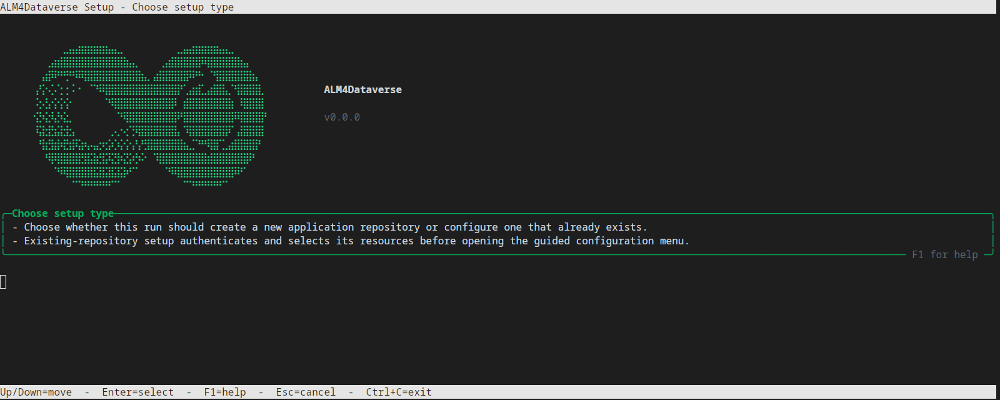

#### Step 1 — Configure branches, dev and deployment envs

The branch editor is where you define branch names and configure DEV environments,
deployment targets, and BUILD validation separately for each branch. These settings
are all part of **Configure branches, dev and deployment envs**; there are no separate
DEV, deployment, or BUILD-validation setup steps. The guided menu lists each branch
and its configured environments as selectable nested rows.

1. **Choose a branch strategy for a new repository.** Select `main only` or
   `main + develop`. This creates the starting branch mappings; it does not configure
   branch protection or pull-request policies. Existing repositories go directly to
   the branch table and skip this prompt. Their mappings come from `alm-config.psd1`;
   if it has no branch mappings, setup starts with the repository's default branch.

   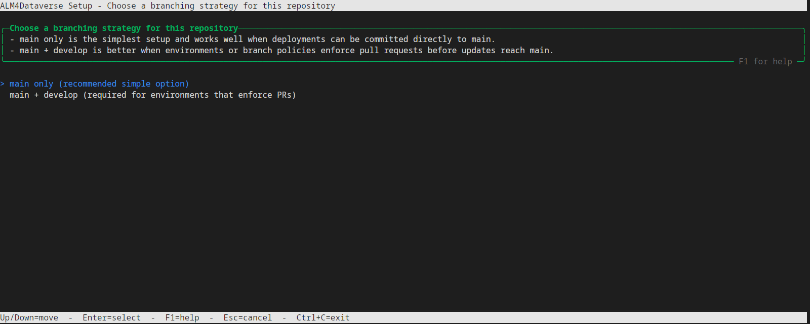

2. **Add or edit branch mappings.** The strategy supplies the initial `main` and,
   optionally, `develop` mappings. To add another branch, choose **Add a branch
   mapping** and enter its branch name. To change an existing branch, choose **Edit a
   branch mapping** and select it. Branch names must be unique.
   The branch edit menu shows the selected branch's current DEV environment,
   deployment targets, and BUILD validation above its actions.

   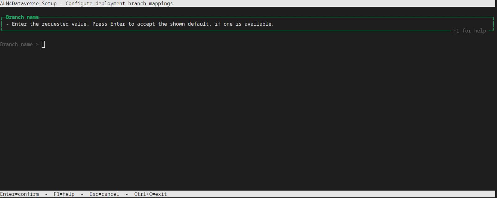

3. **Choose whether each branch has a DEV environment.** For a new, unconfigured
   GitHub branch, the confirmation defaults to **No**. Choose **Yes** to select a
   Dataverse environment; setup assigns it the name `Dev-<branch>`. The name is
   generated from the branch and is not entered separately. Choose **No** when the
   branch has no DEV environment; that branch cannot be selected later as the source
   for discovering solutions. After choosing **Yes**, the environment detail menu
   opens. Its generated target-name row is already complete and locked; select the
   Dataverse environment, credentials, and service account in their separate rows.
   Existing DEV mappings open in the same editor with their current values.

   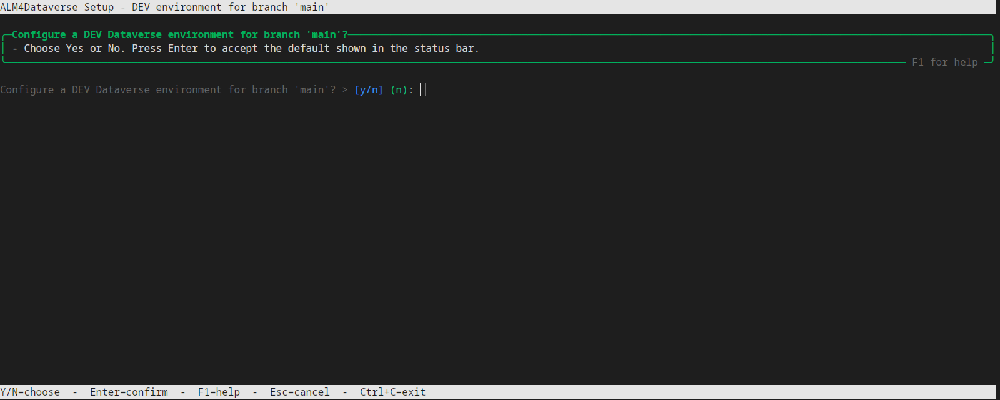

   

4. **Choose credentials and the process-owner account.** The environment detail menu
   keeps credentials and the service-account UPN as separate steps after Dataverse
   selection and target naming. Depending on what is already configured or selected in
   this setup run, the credential menu offers creating an App Registration, entering
   existing App Registration details, or reusing an available credential. A new
   registration asks whether to use workload identity federation or a client secret.
   The service-account menu similarly lets you enter or reuse an account. Reuse the
   same identity only where that is appropriate for your environment boundaries.

   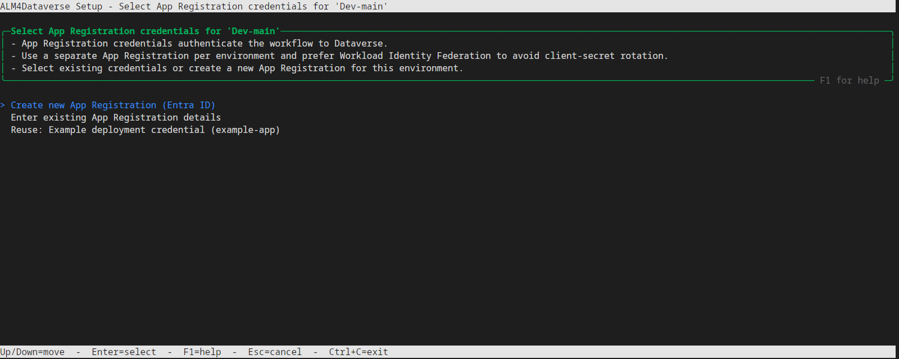

   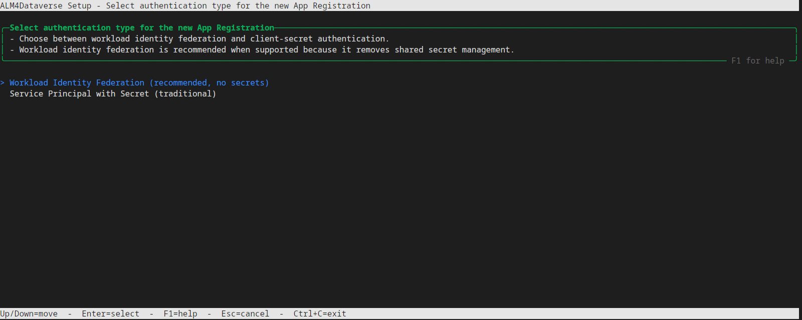

   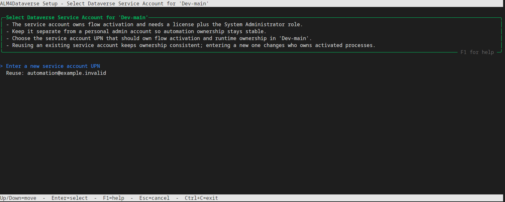

   The service account is a licensed user for process ownership, not the application
   identity used to authenticate deployment. A manually entered UPN is format-checked;
   setup does not verify its licensing or Dataverse roles. If you choose a client
   secret, follow the prompts to store it as a GitHub secret. Never put secret values
   in `alm-config.psd1` or commit them.

5. **Add deployment targets for the branch.** Choose **Add an environment** to open its
   detail menu. Complete the Dataverse environment, short name (for example, `TEST`,
   `UAT`, or `PROD`), credentials, and service-account rows in order. Later rows remain
   locked until earlier parts are complete. The branch's DEV environment is excluded
   from the deployment choices. The same menu opens when you select an existing target
   to edit; changing its Dataverse URL clears credentials and service-account ownership
   selected for the old target. Previously selected credentials and accounts may be
   offered for reuse. Choose **Done** when the list is complete. A branch may have no
   deployment targets.

   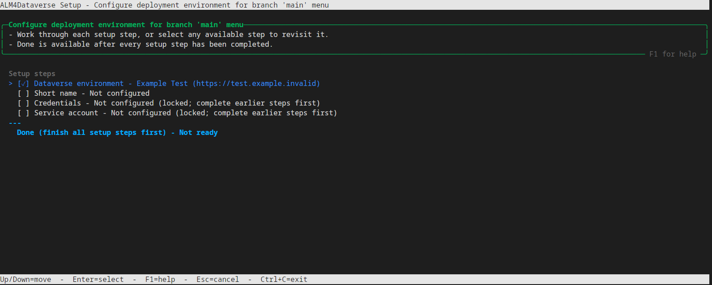

   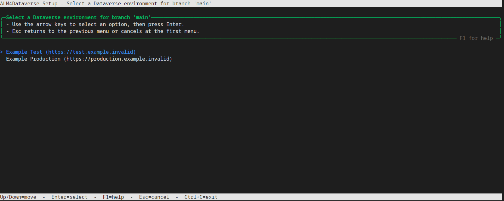

   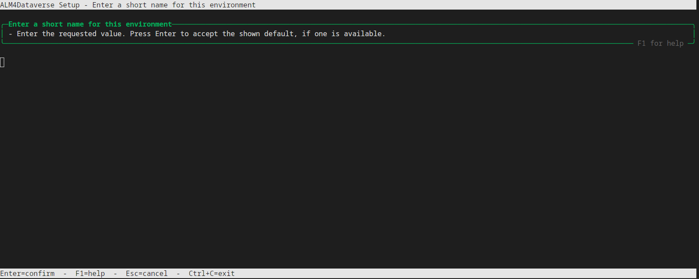

   Add deployment targets in promotion order: the list order becomes the generated
   deployment-stage order. There is no move action, so remove and re-add an environment
   to change its position. The plan below shows the URL, credential type, and service
   account for each selected target.

   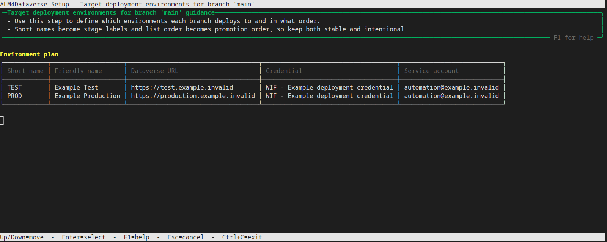

6. **Configure BUILD validation for each branch.** Choose whether to deploy the
   branch's BUILD artifact to a Dataverse validation environment. If enabled, its
   detail menu separates Dataverse selection, GitHub environment name, credentials,
   service account, and BUILD baseline into ordered rows. Configure the baseline row
   even when no baseline is needed; choosing no baseline is valid. When a baseline is
   selected, it must be a deployment environment. This is separate from the branch's
   DEV and deployment targets.

   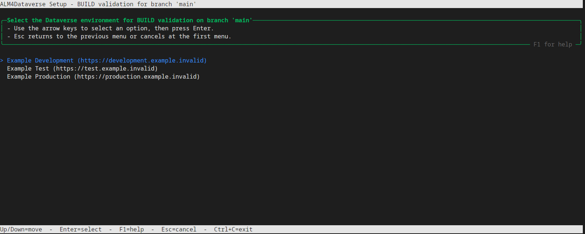

7. **Review the branch map.** After configuring a branch, setup returns to the mapping
   table. Add, edit, or remove mappings until the table shows the intended assignments,
   then choose **Done**. You can reopen a branch to edit its DEV environment, deployment
   targets, or BUILD validation settings. The example shows two branches with separate
   DEV environments and deployment targets.

   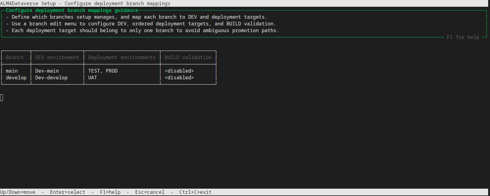

#### Step 2 — Configure solutions

Choose a branch with a DEV environment as the solution discovery source, then select
and order the solutions. The selected-solution summary is rendered in dependency order:

```text
Selected solutions (dependency order)
┌───┬───────────────┬─────────────┐
│ # │ Friendly name │ Unique name │
├───┼───────────────┼─────────────┤
│ 1 │ Example Core  │ ExampleCore │
└───┴───────────────┴─────────────┘
```

#### Step 3 — Configure GitHub OIDC identity

When at least one selected credential uses Workload Identity Federation and immutable
subjects are not already enabled, setup asks whether to enable them. The repository
setting is changed only during Apply. The prompt for the example repository is:

```text
Enable immutable GitHub OIDC subjects for 'example-org/sample-app'?
```

#### Optional — Preview changes

After all required setup steps are complete, select **Preview changes** to inspect the
generated files and deferred resource plan. Preview is optional and does not need to be
selected before Apply. The summary includes the configured branches, environment
mappings, provider options, solution choices, and counts of files to add, modify, or delete. It also lists
deferred GitHub, Entra ID, and Dataverse operations: repository OIDC settings,
environment variables/secrets and approvals, federated credentials, and Dataverse
application and service-account users/roles. This is a plan based on the selected
setup, not a live before/after resource diff; an **Ensure** operation may find the
resource already in its desired state. Prerequisites already applied to let setup
proceed are excluded. Secret values are never displayed.

The review menu separates the config-only diff from the diff of every repository file
that setup will change:

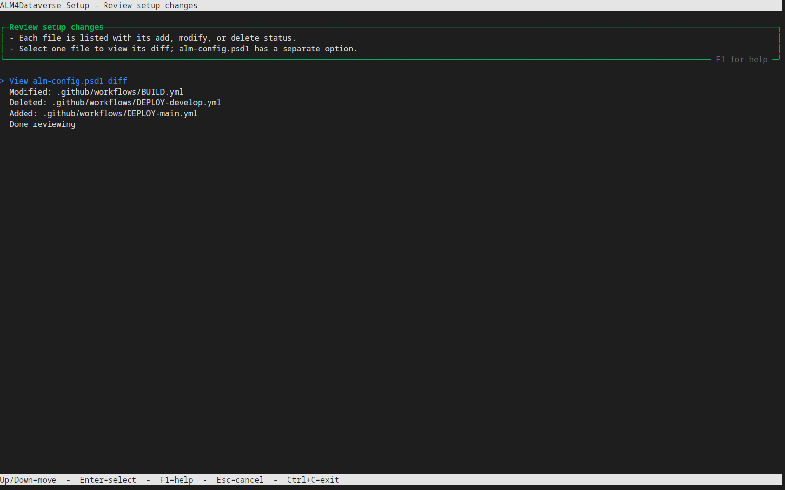

The file list labels each change as added, modified, or deleted. Select
**View alm-config.psd1 diff** for the separate config view, or select a status-labeled
repository file to open its diff. Only one file is shown at a time. The diff is colored
and side by side; scroll with Up/Down or Page Up/Down, jump with Home/End, and press Q
or Esc to return to the file list. These previews are generated in a temporary tree
and leave the selected repository unchanged.

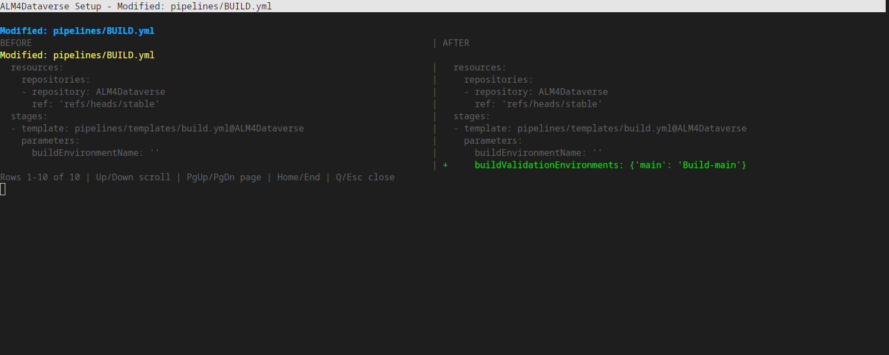

#### Exit without applying changes

This action is always available in the main menu. Select **Exit without applying changes**
and confirm to leave setup without publishing the generated files or applying the deferred
GitHub, Entra ID, and Dataverse operations. Choose **No** or press **Esc** at the
confirmation to return to the menu. Resources changed during earlier prerequisite steps
are not rolled back.

#### Step 4 — Apply changes

The bold cyan **Apply changes** action is unavailable until all required setup steps
are complete. **Preview changes** also becomes available then, but remains optional.
When ready, Apply moves to the first position in its action group and is highlighted.
Selecting it publishes the generated files according to each branch's
publication plan and applies the listed GitHub, Entra ID, and Dataverse settings; you
do not have to preview first. If publication creates a pull request, these external
operations still happen during setup; only the repository-file changes wait for that
pull request to merge.

On success, the completion panel links to the repository's Actions page. Its example
output is:

```text
╭─Ready to open────────────────────────────────────────────────────────────────╮
│                                                                              │
│ The guided setup has finished and the generated automation assets are ready  │
│ for review.                                                                  │
│ Open your GitHub Actions page:                                               │
│ https://github.com/example-org/sample-app/actions                            │
│                                                                              │
╰──────────────────────────────────────────────────────────────────────────────╯
```

If Apply fails, the error is displayed and setup returns to the menu with all
selections retained. You can edit a step and select **Apply changes** again; remote
changes that already succeeded are not rolled back. The retry notice is:

```text
Your setup selections are still available. Edit a step or select Apply changes to retry.
```

### Apply a committed config without editing settings

Use this mode when `alm-config.psd1` has already been reviewed and committed to the
application repository's default branch, and you want to regenerate its workflows
without running the settings editors:

```powershell
.\setup-github.ps1 -ApplyConfig
```

To inspect committed config changes without publishing:

```powershell
.\setup-github.ps1 -ApplyConfig -PreviewOnly
```

1. Authenticate to GitHub when prompted. This mode does not sign in to Azure.

2. Select an existing repository. This mode does not offer repository creation.

   ```text
   Selected: example-org/sample-app
   ```

3. Setup reads `provider`, `repository`, `ref`, provider options, and branch mappings
   from the committed config. It does not infer missing values from existing workflows
   or configure GitHub environments, secrets, OIDC subjects, or approvals.

   ```text
   Reading shared workflow source from alm-config.psd1
   Shared workflow repository: example-org/sample-workflows
   Shared workflow reference: stable
   ```

4. The shared-workflow-repository row appears first and is locked to committed config.
   **Choose publication methods** is a required step. **Preview changes** is optional in
   the separate action group and becomes available after all required steps are complete;
   it can be used to inspect the config and generated-file diffs. **Apply changes**
   becomes ready at the same time and may be selected without previewing. The config has
   a separate diff, and each repository
   file is selectable from the status-labeled change list.

   `-PreviewOnly` skips the publication-plan step and opens the same status-labeled file
   picker. Select one file to print its complete diff without paging; return to the
   picker to inspect another file, then choose **Done reviewing** to exit. It requires
   `-ApplyConfig` and never modifies or publishes repository files. Its resource section
   reports that no external resources will be modified; this mode does not plan or
   provision GitHub, Entra ID, or Dataverse changes.

5. Optionally select **Preview changes** to review the diff, then select **Apply
   changes** when ready. Setup publishes the generated repository files and returns to
   the menu with selections intact if publication fails. The completion panel is the
   same as [Step 4](#step-4--apply-changes). Missing or
   invalid provider, repository, ref, or branch metadata stops before publication.

> [!IMPORTANT]
> Verify plan compatibility and the generated protection rules. Setup selects
> `environment-approval` when it detects support, or repository variables (optionally
> environment-prefixed) plus
> `manual-gate-tag` otherwise. The fallback still stores client secrets in the matching
> GitHub environment; it does not make private GitHub Free repositories a fully supported
> out-of-the-box configuration.

Re-running setup can update generated files. Existing `secrets-json` mappings, including
separate deployment-stage mappings, `AGENTS.md` and files under `data/` are preserved.
Review the resulting diff and stored settings; other local workflow customizations can be
overwritten (see [re-running setup](../usage/updating.md#re-run-setup-carefully)).
GitHub cannot reveal existing secret values for automatic relocation.

To select a tenant (`TenantId`) or shared code ref (`ALM4DataverseRef`), see
[setup parameters](../config/pipelines.md#setup-script-parameters). Released scripts
embed their helpers; raw repository scripts need the adjacent files in this repository.

## Manual Setup

### 1. Prepare Application Identities

For each target, register an app in Entra ID and record its application/client ID and
tenant ID. In the Power Platform admin center, select the Dataverse environment, add
an **Application user** for that app, and assign the required role.

Choose authentication:

- **WIF/OIDC:** add a federated credential with issuer `https://token.actions.githubusercontent.com`, audience `api://AzureADTokenExchange`, and the exact job subject. No client secret is needed.
- **Client secret:** create a secret and retain its value in GitHub Secrets, not source control. Track its expiry and rotation process.

The [credential reference](../config/github-secrets.md#entra-id-federated-credential-setup)
shows both legacy and immutable subject formats. For environment-based jobs, create a
credential for each relevant GitHub environment, including BUILD validation when enabled.

> [!NOTE]
> **Advanced: immutable OIDC subjects.** Setup can offer to enable these on existing
> repositories. Review other applications trusting the old subjects before changing
> this repository-wide setting.

Official guidance: [app registrations](https://learn.microsoft.com/en-us/entra/identity-platform/quickstart-register-app),
[Dataverse application users](https://learn.microsoft.com/en-us/power-platform/admin/manage-application-users),
and [GitHub OIDC with Azure](https://docs.github.com/en/actions/security-for-github-actions/security-hardening-your-deployments/configuring-openid-connect-in-azure).

### 2. Copy The Application Files

Copy the following from a consistent ALM4Dataverse release into your application repository:

| Source | Destination |
| --- | --- |
| [alm-config.psd1](../../copy-to-your-repo/alm-config.psd1) | Repository root |
| [AI-agent context](../../copy-to-your-repo/AGENTS.md) | `AGENTS.md` at the repository root |
| [data](../../copy-to-your-repo/data) | `data/` |
| [GitHub workflows](../../copy-to-your-repo/.github/workflows) | `.github/workflows/` |

Include the hidden `.github` directory. Do not copy the Azure DevOps `pipelines` callers
unless you also intend to configure that platform. Select a tested action/workflow ref
instead of unintentionally following the template's `@main` references.

Automated setup syncs the same `AGENTS.md` scaffold. Keep it in the application repository
and ask an AI agent to read it before changing Dataverse components or ALM configuration.

The caller workflows are BUILD, EXPORT, IMPORT, DEPLOY-main, and CLEANUP-RELEASES.
Configure `solutions` using unique names in dependency order, then customize optional
assets, hooks, checker rules, and validation in the [ALM configuration](../config/alm-config.md).
Do not add plaintext secrets to that file.

### 3. Configure Credentials

Follow the [environment checklist](github-variables.md) for `Dev-main`, your deployment
targets, and optional BUILD validation environment. The job's `environment` selects
GitHub environment settings; `environment-name` tells the action which configuration
prefix to resolve. Keep them consistent.

Pass `${{ toJSON(vars) }}` as `vars-json`. Explicitly select each secret in `secrets-json`,
using `toJSON(secrets.NAME)` to escape its value. For prefixed repository secrets, map the
stored prefixed name to the runtime unprefixed name in each stage. Do not duplicate a
setting in multiple forms and rely on ambiguous precedence.

## Credential Configuration

The complete settings are maintained in one [credential reference](../config/github-secrets.md):

| Requirement | Reference |
| --- | --- |
| Environment values with WIF | [WIF settings and subjects](../config/github-secrets.md#approach-1-workload-identity-federation-oidc) |
| Environment values with a client secret | [Client-secret settings](../config/github-secrets.md#approach-2-github-environments-with-client-secret) |
| Repository values | [Repository variables and secrets](../config/github-secrets.md#approach-3-repository-variables-and-secrets) |
| Connection references and Dataverse variables | [Per-solution settings](../config/github-secrets.md#per-solution-connection-references) |
| Custom secrets and process-owner keys | [Explicit mapping](../config/github-secrets.md#per-solution-environment-variable-values) |

## Deployment Configuration

Edit DEPLOY-main to contain one job per target environment. Configure the job environment,
action `environment-name`, `previous-environment-name`, `promotion-mode`, and
`trigger-branch`. Keep `github-context-json: ${{ toJSON(github) }}` and
`caller-inputs-json: ${{ toJSON(inputs) }}` unchanged.

### Environment Approval Mode

The copied caller explicitly uses `environment-approval`. A successful BUILD sends
`alm4dataverse-build-deploy-<branch-token>` through `repository_dispatch`; the first
stage starts, and later stages follow successful predecessors.

> [!IMPORTANT]
> Configure actual GitHub environment required reviewers where supported. Without
> protection rules, `environment-approval` can deploy through every stage automatically.

For a manual run, leave `target-environment` empty to start at the first stage, or set
it to a named stage. The `build-run-name` selector can be an exact Release tag, BUILD
name, or numeric BUILD run ID; blank means the latest successful BUILD from the selected
branch. For promotion, use an explicit identity so a newer build is not selected by accident.

### Manual Gate-Tag Promotion

`manual-gate-tag` is the alternative when required reviewers are unavailable, such as
private Pro/Team repositories. It does not make private GitHub Free repositories work:
the supplied jobs still need GitHub environments, which private Free repositories
lack. See [plan limitations](#github-licence-limitations).

To adapt the supplied caller:

1. Set every stage's `promotion-mode` to `manual-gate-tag`.
2. Remove the `repository_dispatch` trigger.
3. Make `target-environment` a required choice containing your target names.
4. Give each job a manual selection condition. Jobs with `needs` must use a status-aware condition, such as `!cancelled()`, so a skipped earlier job does not suppress the selected stage.
5. Set each later stage's `previous-environment-name` to its predecessor.

For example, the selection condition on a manual PROD job can be:

```yaml
if: ${{ !cancelled() && github.event_name == 'workflow_dispatch' && inputs.target-environment == 'PROD' }}
```

Run DEPLOY manually for the first target, inspect the result, then run it again for the
next target with the **same build identity**. Later stages require a success tag for
that build in the previous environment. These tags enforce recorded order, not a separate
person's approval. Anyone able to modify trusted workflows, credentials, or gate tags
can affect that control, so secure those permissions.

### Branches And Additional Stages

For another deployment branch, create a matching DEPLOY caller and update its name,
branch filters, dispatch event, `trigger-branch`, and target settings consistently.
The dispatch token is the lowercase branch name with non-alphanumeric runs replaced
by `-`, trimmed at the ends: `feature/customer-import` becomes `feature-customer-import`.
Avoid normalized-name collisions.

> [!NOTE]
> **Advanced: dispatch branch context.** Repository-dispatch workflows must exist on the
> repository's **default branch**. They use the payload to select the source branch/build,
> but the workflow's GitHub ref still comes from the default branch. Account for that in
> environment deployment-branch policies. See [branching strategies](../usage/branching-strategies.md).

To add UAT, add a job, target choice if applicable, credentials, and concurrency group;
chain it with `needs` and update PROD's predecessor. Test automatic and targeted manual
runs. The [action reference](../config/pipelines.md#deploy) defines all supported inputs.

## BUILD Validation And Pull Requests

Setup writes BUILD validation settings under
`branches.<branch>.buildValidation`. Configure an environment name and, optionally,
`baselineRelease` for each branch that should run validation. The selected environment
needs its URL, credentials, process-owner UPN, connections, and Dataverse values. Existing
branch settings seed the wizard; new branches can leave BUILD validation disabled.

> [!CAUTION]
> Use a dedicated non-production Dataverse environment for BUILD validation. It is
> updated in place, not reset. Branches may use separate environments or deliberately
> share one; serialize builds that could update the same environment.

Optionally set each branch's `buildValidation.baselineRelease` to a retained build or
`@<deployment-environment>`. That source environment is separate from the validation
target. The legacy top-level `buildValidation.baselineRelease` is only a fallback for
older configurations; see the [configuration reference](../config/alm-config.md#setup-metadata-and-branch-environments).

Enable Solution Checker separately if required. It checks package quality, not end-user
behavior. The copied BUILD workflow runs on branch pushes, manual dispatch, and export
dispatch, not `pull_request`. Configure required status checks in repository policies;
add PR-merge/merge-queue validation separately when required. Do not expose privileged
credentials to untrusted PR code. See [building releases](../usage/building-releases.md).

## Workflow Job Timeouts

Caller jobs run on `ubuntu-latest` and request `timeout-minutes: 360` at job level.
Do not pass a timeout as a composite-action input. DEPLOY's example concurrency groups
use `cancel-in-progress: true`; EXPORT/IMPORT use a shared development-environment group
with cancellation disabled. Review the consequences of cancellation for server-side imports.
See [timeouts](../config/alm-config.md#import-timeout).

## GitHub Licence Limitations

| Capability | Public repositories on Free/Pro/Team | Private Free | Private Pro/Team |
| --- | --- | --- | --- |
| GitHub Actions | Available, subject to policy/limits | Available, subject to limits | Available, subject to limits |
| Environments and environment secrets/variables | Available | Not available | Available |
| Required reviewers and wait timers | Available | Not available | Not available |
| Environment deployment branch/tag restrictions | Available | Not available | Available |

For private-repository required reviewers, check the applicable GitHub Enterprise offering.
These are platform capabilities, not features ALM4Dataverse can enable on an unsupported
plan. Prefixed repository credentials and manual gate tags are not equivalent to protected
environment secrets and independent approval.

Consult [environment availability](https://docs.github.com/en/actions/how-tos/deploy/configure-and-manage-deployments/manage-environments),
[protection rules](https://docs.github.com/en/actions/reference/workflows-and-actions/deployments-and-environments),
and [current Actions limits](https://docs.github.com/en/actions/reference/limits).
The supplied Linux jobs should not be budgeted using Windows-runner multipliers.

## Grant Permissions For Workflow Operations

Keep the caller's explicit job-level permissions, described in the
[permissions reference](../config/pipelines.md#caller-settings-and-permissions), and
verify organization/repository policy permits them. EXPORT needs to push source changes;
BUILD publishes tags and Releases; DEPLOY writes success/pointer tags; cleanup deletes
managed Releases. Branch and tag rules must permit these intended operations.

> [!NOTE]
> **Advanced: custom dispatch tokens.** EXPORT normally uses `GITHUB_TOKEN` to dispatch
> BUILD after committing. Its default mapping also accepts an optional
> `WORKFLOW_DISPATCH_TOKEN` or legacy `GH_WORKFLOW_TOKEN` secret when policy requires one.
> Dataverse credentials do not grant GitHub repository access. Do not grant broad default
> token access when explicit job permissions suffice.

## First Run

1. Commit the configured callers and configuration to the default branch.
2. Run EXPORT from the intended development branch with a meaningful commit message.
3. Review the exported `solutions/<unique-name>` files and any data changes.
4. Check the resulting BUILD and its Release. A build before the first export may fail because solution source is not present yet.
5. Deploy that exact build to the first non-production target and verify process activation and application behavior.
6. Promote the same build through the remaining configured targets.

Use IMPORT to seed or synchronize a development environment from source, not to promote
a release. Keep CLEANUP-RELEASES on the default branch and review its retention policy.
Continue with [exporting](../usage/exporting-changes.md), [building](../usage/building-releases.md),
[deploying](../usage/deploying.md), or [importing](../usage/importing-changes.md).
