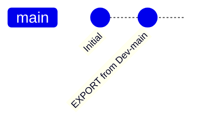
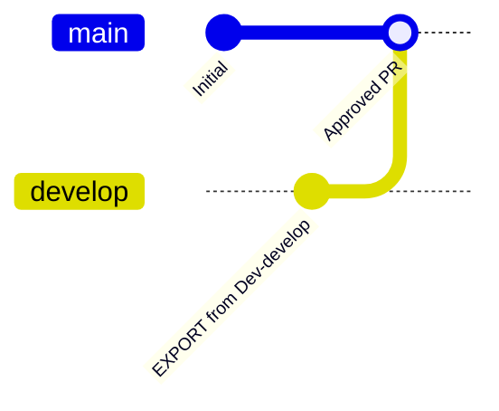
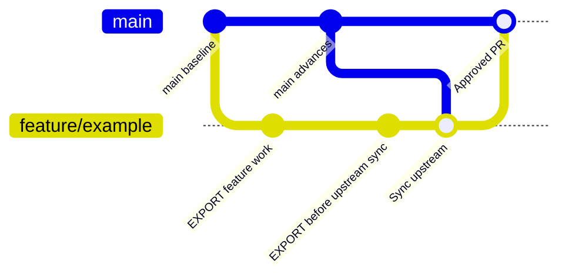

# Branching Strategies

ALM4Dataverse can build and deploy from multiple branches. `EXPORT` writes
changes from the development environment associated with the selected branch
back to that branch. `BUILD` runs when repository changes are made, and the
branch's `DEPLOY-<branchname>` workflow deploys that branch's build to its
configured environments.

The examples below show three common patterns. The environment names and
deployment targets are examples; configure each branch's pipelines/workflows
and environment credentials for your own organization.

## Build validation and pull requests

`BUILD` runs when changes are pushed to a branch, including commits created by
`EXPORT`. Optional PAC Solution Checker analysis checks packed solutions for
rule findings and can fail the build at its configured severity threshold.
Separately, BUILD can connect to a shared Dataverse validation environment to
authenticate and confirm access, then deploy the generated artifacts there
using the normal deployment process. This validates that imports/upgrades and
configured deployment hooks complete; it changes that environment and is not
a runtime/functional test or a `DEPLOY` target.
See [Building Releases](building-releases.md) for how these validations work
and how to configure a successful build as a PR/branch-policy requirement.
If a baseline release is configured, BUILD deploys that successful package to
the validation environment before the candidate from the current branch; the
baseline source environment is separate from the validation target.

For the `main`/`develop` and feature-branch models below, configure your
repository's PR policy to require successful validation before merging into
`main`. ALM4Dataverse builds branch pushes, but does not automatically create
the host platform's branch protection or PR policy. The default GitHub BUILD
workflow checks pushed branch commits and does not have a `pull_request`
trigger; add PR-triggered or merge-queue validation separately if your policy
requires a fresh build of the proposed merge result.

## Main only

Use this simple pattern when developers are allowed to export directly to
`main` and the repository does not require pull requests for changes to `main`.

Each `EXPORT` takes the configured solution state from `Dev-main` and commits
any detected changes directly to `main`. The resulting change triggers
`BUILD`; deploy the `main` build to Production using `DEPLOY-main`, with any
required approval gate configured on the Production environment. This is a
shared-development-environment model: everyone works in the same `Dev-main`
environment and exports its changes to `main`.

| Branch | `EXPORT` source environment | Branch updated by `EXPORT` | `DEPLOY` target |
| --- | --- | --- | --- |
| `main` | `Dev-main` | `main` | Production |

Because exports write directly to `main`, this pattern is not suitable when
corporate policy requires a pull request before changes can enter `main`.
Use the `main` and `develop` pattern below for that policy.

## Main and develop

Use `develop` as the integration branch for ongoing work. `EXPORT` commits
changes from `Dev-develop` directly to `develop`. When those changes are ready
for release, open a pull request from `develop` into `main`. Require the
appropriate BUILD validation policy on `main`. The pull request
is reviewed and approved according to your organization's policy; merging it
promotes the commits to `main` and triggers a `BUILD` from `main`.

Each export to `develop` triggers a BUILD for that branch. Check that the
latest `develop` build and its enabled validation checks succeed before opening
the release PR; the required PR policy then enforces validation before merge.

Deploy builds from `develop` to a non-production environment for integration
testing. After the PR is merged, deploy the `main` build to Production, where
you can require a separate environment approval. This keeps production
deployment tied to the reviewed `main` history. This is also a shared
development-environment model: everyone working on `develop` shares
`Dev-develop` and coordinates exports from it.

| Branch | `EXPORT` source environment | Branch updated by `EXPORT` | `DEPLOY` target |
| --- | --- | --- | --- |
| `develop` | `Dev-develop` | `develop` | Dev/Test or another non-production environment |
| `main` | Not used for routine changes | Updated by the approved PR from `develop` | Production |

The pull request is the promotion step: do not run `EXPORT` against `main` for
routine work, since that would bypass the required review. Configure
`DEPLOY-develop` and `DEPLOY-main` with their respective targets and policies.
As with any shared development environment, coordinate exports to `develop`:
an export includes all changes to the configured solutions in its source
environment, not a hand-picked subset. See [Exporting Changes](exporting-changes.md)
for details.

## Feature branch per feature

Use a separate branch and development environment for each feature when
developers need to work independently. In this example, feature branches start
from `main` and are merged into `main` through a pull request. Each branch has
its own convention-based development environment, `Dev-<branchname>` (for
example, branch `feature/customer-import` uses `Dev-feature/customer-import`,
subject to your CI platform's environment naming rules).

Run `IMPORT` for the feature branch when creating or preparing its development
environment, so it starts from the branch's source-controlled contents. If
changes have since been merged into or rebased onto the feature branch from
upstream `main`, run `IMPORT` again to bring the feature environment up to
date.

Before merging or rebasing upstream changes into your feature branch, run
`EXPORT` from that feature's development environment to commit its current
work to the feature branch. Then merge or rebase the upstream changes and run
`IMPORT` for the feature branch. This order preserves environment changes in
source control before `IMPORT` updates the environment from the integrated
branch.

Each export to a feature branch triggers a BUILD for that branch. Review its
result and any enabled Solution Checker report, and resolve failures before
opening the PR. After syncing upstream changes, check the new branch BUILD as
well; configure the required PR policy on `main` to prevent merging until
validation succeeds.

Open a pull request from the feature branch into `main` when the feature is
ready, and require the appropriate BUILD validation policy on `main`. `BUILD`
runs for repository changes; deploy the `main` build to
Production after the PR is approved and merged. A feature branch can also have
its own `DEPLOY-<branchname>` target for isolated testing, but that is optional
and separate from the feature's development environment used by `EXPORT` and
`IMPORT`.

| Branch | `EXPORT` source environment | Branch updated by `EXPORT` | `DEPLOY` target |
| --- | --- | --- | --- |
| `feature/<name>` | `Dev-feature/<name>` | That feature branch | Optional isolated test environment |
| `main` | Not used for routine feature work | Updated by approved PRs from feature branches | Production |

For `IMPORT` and `EXPORT` instructions, see [Importing Changes](importing-changes.md)
and [Exporting Changes](exporting-changes.md).
