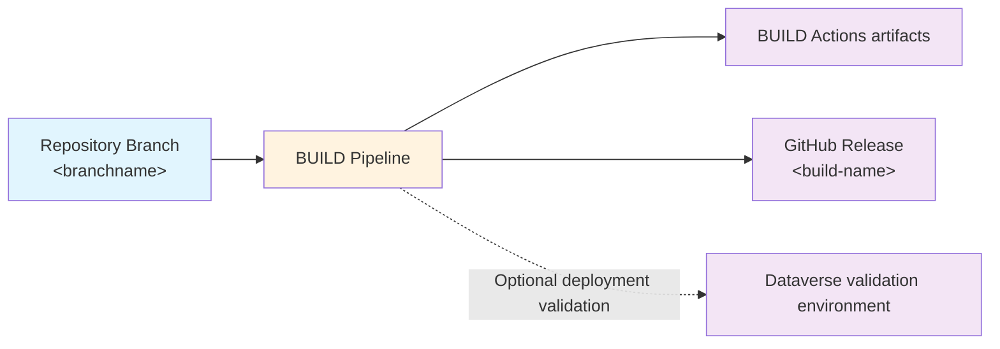

# Building Releases

The `BUILD` pipeline collates a numbered release by extracting and building the assets required to deploy from source control. This can then be used later to deploy to any number of environments using the exact same, unchanged assets. When configured, BUILD also deploys its generated artifacts to a Dataverse validation environment, exercising the deployment process before promotion. BUILD can additionally run PAC Solution Checker against packed solutions.

On GitHub Actions, each successful branch BUILD publishes the same separate
deployment archives as both Actions artifacts and GitHub Release assets:

- `artifacts.zip` — the deployment artifacts, including solutions, configured
  assets, scripts, configuration, and dependency locks.
- `solution-check-report.zip` — published when a solution-check report exists.

The Release is not a different deployment package. Existing Actions artifacts
remain available for compatibility and fallback deployments.

The `BUILD` job triggers automatically when any changes are made in the associated repo, including when `EXPORT` completes (unless no changes were found). The copied GitHub workflow and Azure Pipeline trigger on pushes to branches; setting a repository's PR or branch policy to require successful validation is a separate configuration step.

## BUILD validation

BUILD validation has two optional parts: deploying the generated solution
packages to a Dataverse environment, and statically analyzing those packages
with PAC Solution Checker.

### Dataverse validation environment

This is a configured Dataverse environment that BUILD connects to using its
configured service connection or GitHub environment credentials. BUILD first
authenticates and calls `WhoAmI` to confirm access. After generating the
deployment artifacts, it runs the normal deployment script from those
artifacts against the validation environment. This imports the packaged
solutions using the configured deployment and upgrade behavior and runs
configured deployment hooks. A failure to import, upgrade, or complete a hook
fails the BUILD run.

Automated setup can configure one shared validation environment for generated
BUILD pipelines/workflows, so builds from different branches deploy to that
same environment. It is separate from each branch's `Dev-<branchname>`
environment and from the environments in `DEPLOY-<branchname>`. Choose a
non-production environment that is safe to update repeatedly: BUILD does not
reset it, and deployments may update installed solutions or run configured
deployment hooks. Concurrent builds from different branches also use the same
environment, so serialize builds or configure separate validation environments
if they could interfere. This validates that the deployment process succeeds;
it does not prove the solution's end-user behavior.

Automated setup wires the validation environment into BUILD. For manual
configuration, Azure DevOps uses the `buildEnvironmentName` parameter in
`pipelines/BUILD.yml`, with a matching Power Platform service connection and
`Environment-<name>` variable group. GitHub Actions uses the same name for the
BUILD job's GitHub `environment` and the action's `environment-name` input.
The credentials and deployment settings must be available to that job. See
[Azure DevOps setup](../setup/azdo-manual-setup.md) and
[GitHub setup](../setup/github-setup.md).

### Optional baseline release

BUILD validation can deploy a previously successful BUILD package before the
candidate package. This is useful when the validation environment needs the
same installed-solution baseline that a target environment currently has.
Both packages are deployed with the normal deployment process and their own
packaged configuration. If a configured `@environment-name` has no successful
deployment pointer yet, BUILD warns and validates only the candidate. Other
baseline resolution, download, or deployment failures fail BUILD before the
candidate is deployed.

Configure `buildValidation.baselineRelease` in `alm-config.psd1`:

- Leave it empty to deploy only the current candidate.
- Use `@<environment-name>` to resolve the most recently successfully
  deployed BUILD run recorded for that deployment environment.
- Use a fixed build identifier: an Azure DevOps BUILD run ID or build number;
  or a GitHub BUILD run ID or GitHub Release tag. GitHub resolves a run ID to
  its Release and downloads the durable `artifacts.zip` asset, not the
  expiring Actions artifact.

Automated setup asks for a baseline source deployment environment separately
from the Dataverse validation target. It also offers a no-baseline choice.
On initial use, the selected source may not yet have a successful deployment;
the first BUILD then warns and deploys only the candidate. After a successful
`DEPLOY` to the source, subsequent builds use that deployed version as the
baseline. Do not select the BUILD validation target as the baseline source:
BUILD does not update deployment pointers when it writes to its validation
environment.
For environments deployed before build-ID pointers were introduced, the
resolver uses the existing source-commit pointer to find a unique successful
build. If more than one successful build matches that commit, configure a
fixed build identifier to avoid guessing which package was deployed.

GitHub release cleanup keeps Releases referenced by active deployment pointers,
so their packaged baseline assets remain available. A fixed GitHub baseline
Release must also be retained (cleanup may remove an old Release that is no
longer an active deployment). Azure DevOps baseline artifacts must be retained
by the project’s pipeline retention policy. If the referenced Release or
pipeline artifact has been removed, BUILD fails with a resolution/download
error; choose a retained baseline or adjust retention.

### PAC Solution Checker

When `solutionCheck.enabled` is `$true` globally or for an individual
solution, BUILD runs `pac solution check` against that solution's packed
solution zip before deploying. This is a static solution-quality check; it
reports rule findings and does not replace deployment validation or run
functional tests in an environment. If the checker fails its threshold, BUILD
fails and the validation deployment does not proceed.

`solutionCheck.failThreshold` determines the severity at which findings (or
higher) cause BUILD to fail (default: `Critical`), and
`solutionCheck.maxParallel` limits how many solution checks run concurrently (default: `4`). The checker
uses the runner's non-interactive Azure identity context. A Dataverse
deployment validation environment is optional for PAC Solution Checker if that
identity context is otherwise available. See [Solution Check configuration](../config/alm-config.md#solution-check-pac-solution-check)
for configuration examples, settings, authentication behavior, and reports.

To monitor:

**Azure DevOps:**
1) Navigate to the **Pipelines** area of your AzDO project.
2) Select the **All** tab and navigate to the folder with the same name as your repo. (If you only have one repo, this will be the same as your project name by default.)
3) Select the `BUILD` pipeline and then select an instance of the job.
4) The view will switch automatically to show progress. Wait until it is shown as successful.

**GitHub Actions:**
1) Navigate to the **Actions** tab of your repository.
2) Select the **BUILD** workflow from the left panel.
3) Select the running workflow run. Wait until it is shown as successful (green checkmark).
4) Open the repository's **Releases** page and find the Release for the build tag.

What happens:

- Solution(s) are packed from the folders in source control at `solutions/uniquename` using PAC solution pack. A managed solution is generated and added to the build assets.
- The optional PAC Solution Checker and Dataverse deployment validation run as described in [BUILD validation](#build-validation).
- If you've configured any hook extensions in `alm-config.psd1`, these will be executed and can add to the build steps and the assets.
- Any additional paths configured in `assets` will be copied to the build assets.
- The configuration and scripts for the deployment process are also copied to the build assets to ensure that everything is frozen in time.

The BUILD result is useful as a merge gate: a failed build or enabled solution check marks that branch's build as failed. ALM4Dataverse does not automatically add branch protection or PR policies. Configure those in your source-control platform if a PR must not merge until validation succeeds:

- **Azure DevOps**: add a **Build validation** branch policy for the target branch and select the BUILD pipeline.
- **GitHub**: add the BUILD status check to the target branch's ruleset or branch protection required checks. The copied BUILD workflow is triggered by pushes, not by `pull_request`; it checks the pushed branch commit. If policy requires validation of the generated PR merge result, configure a PR-triggered workflow or merge-queue validation separately.

Solution check report outputs:

- In build artifacts under `solution-check/`
  - `summary.md`
  - `solution-check-summary.json`
  - per-solution PAC logs/output
- As a dedicated CI artifact named `solution-check-report` for quick access from pipeline/workflow results.

If checks fail, the logs clearly state which solution breached the configured threshold and what the highest severity was.

What to do next:

- The `DEPLOY-<branchname>` workflow uses the Release assets first and falls back
  to the BUILD artifact when needed. See [Deploying](deploying.md) for information.

## GitHub Release cleanup

The copied `CLEANUP-RELEASES.yml` workflow runs on branch deletion, daily, and
manually. It removes managed build Releases from deleted branches and keeps at
most 10 Releases per branch by default, including the default branch. Before an
old Release is deleted, its branch, build name, source commit, and BUILD run ID
are preserved in an annotated `alm4dataverse/metadata/<release-tag>` tag.
