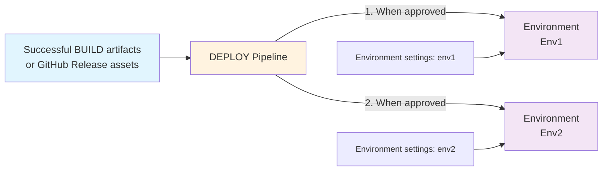

# Deploying

The `DEPLOY-<branchname>` workflow deploys a selected build to one or more
environments using environment-specific settings. On GitHub Actions, the
existing `build-run-name` selector accepts an exact Release tag, BUILD name, or
numeric BUILD run ID. The matching Release assets are preferred, with the BUILD
Actions artifact as fallback.

On GitHub Actions with `environment-approval`, BUILD dispatches the deployment
workflow with the exact Release/build identity. In `manual-gate-tag` mode, an
operator starts deployment from Actions. Azure DevOps continues to use its
selected pipeline resource artifact.

> [!NOTE]
> Build versions and Git tags retain their branch suffix; there is no separate
> stable build promotion step.

## Before You Deploy

1. Select a successful build from the intended source branch and record its exact identity.
2. Verify target credentials, connections, Dataverse values, and the process-owner UPN. Connections and users must already exist.
3. Review solution removals, data migrations, organization settings, and other hooks in that build. Managed deployments can overwrite unmanaged customizations and upgrades can remove components/data.
4. Check that no other import is still running against the target and that approval/concurrency controls are configured.
5. Take or confirm the appropriate environment backup and test a recovery plan for production changes.

> [!NOTE]
> Changing source configuration after BUILD does not change an existing package. Build
> a new release to change its solutions, hooks, defaults, or dependencies. Runtime target
> settings remain external and can change the effect of redeploying the same package.

## Choose A Build And Target

**Azure DevOps:** open the branch's DEPLOY pipeline and choose **Run pipeline**. In
**Resources**, select the `build` resource's exact successful BUILD run. Select applicable
stages if needed, run, and complete any configured approvals. The default pipeline
resource trigger also starts DEPLOY after a matching branch BUILD.

**GitHub Actions:** open the branch's DEPLOY workflow and choose **Run workflow**.
Select the branch and enter `build-run-name` as a Release tag, exact BUILD name, or numeric
BUILD run ID. Blank selects the latest successful build, which may change between manual
promotions. Use an explicit identity when promoting or redeploying.

| GitHub mode | First stage | Later stages | Manual selection |
| --- | --- | --- | --- |
| `environment-approval` | Automatic build dispatch | Chain after success and configured environment protection checks | Empty `target-environment` starts from stage one; a named target selects that stage. |
| `manual-gate-tag` | Manual | Separate manual run per stage; checks predecessor tag for the same build | `target-environment` is required. |

Approval mode does not itself create an approval rule. Without configured protection,
stages run automatically. Gate-tag mode records prior success; it does not require an
independent reviewer. Configure [GitHub deployment modes](../setup/github-setup.md#deployment-configuration)
and [platform plan restrictions](../setup/github-setup.md#github-licence-limitations) deliberately.

> [!IMPORTANT]
> **Configure deployment targets.**
>
> Each `DEPLOY-<branchname>.yml` pipeline/workflow is associated with a single branch and must be edited to add a list of environments to deploy to, in sequence.
>
> **Azure DevOps**: Each environment requires a [service connection](../config/azdo-environment-service-connection.md) for auth and a [variable group](../config/azdo-environment-variable-group.md) for environment-specific values. Add the following variable group policies:
>
> - **Exclusive lock** — ensures only one deployment at a time can touch the environment.
> - **Approval** — requires approvers to sign off before deployment starts.
>
> **GitHub Actions**: Each target requires [variables and secrets](../setup/github-variables.md). Secrets must be listed explicitly in each stage's `secrets-json` input. Required-reviewer availability depends on plan and visibility; private Pro/Team repositories do not have this rule. See [deployment gates](../setup/github-setup.md#deployment-gates-for-github-free) for the manual alternative.

## Monitor A Deployment

**Azure DevOps:**

1) Navigate to the **Pipelines** area of your AzDO project.
2) Select the **All** tab and navigate to the folder with the same name as your repo.
3) Select the `DEPLOY-<branchname>` pipeline and then select an instance of the job.
4) Each environment is displayed as a **Stage** with a status showing which one is currently active.
5) If the stage is pending approval, an approval request is shown. The configured approvers must approve before deployment starts.
6) Once approved, the deployment stage starts. Select the stage to follow progress and check it completes successfully.

**GitHub Actions:**

1) Navigate to the **Actions** tab of your repository.
2) Select the **DEPLOY-main** (or your branch) workflow from the left panel.
3) Select the running workflow run. Each deployment stage is shown as a job.
4) If an environment has required reviewers configured, a review request is shown. Approvers must approve before the stage runs.
5) Select a job to follow its progress and check it completes successfully.

In Azure DevOps and GitHub approval mode, a successful stage allows the next configured
stage to start, subject to checks. In GitHub manual gate-tag mode, start the next stage
separately with the same build identity.

> [!WARNING]
> Before retrying a failed stage, inspect its logs and Dataverse solution history. A
> timeout or cancellation may leave an import running server-side. Hooks may already
> have partially changed data; repeated execution must be safe.

## Deployment Sequence

- **The pipeline waits for all configured policies to be met.**
  For instance the exclusive lock and approval steps.
- **The deployment assets are resolved.** GitHub Actions tries the matching
  Release's `artifacts.zip` first, then downloads the selected BUILD Actions
  artifact if the Release asset is unavailable. Azure DevOps downloads the
  selected pipeline artifact.
- **The name of the deployment job matches the release number.**
- **Environment settings are read from the configuration associated with the environment** (Azure DevOps: variable group; GitHub Actions: GitHub environment values or repository variables, with optional environment prefixes; secrets are selected explicitly in `secrets-json`), matching with those required by each solution.
- **Solutions are deployed if needed in the configured dependency order**:
  - If the solution is already present with the same version, the import is skipped.
  - If the solution is not currently present in the environment, the 'Import' method is used
  - If there's a pending unmerged upgrade with a different version, an error is thrown with details asking you to resolve it. This is not automated because it can result in data loss. You either need to remove (warning - data loss) or apply the prior upgrade before retrying.
  - If there's a pending upgrade for the same version, the 'Stage for upgrade' is skipped
  - If the solution is already present with a different version the 'Update' (if Major.Minor matches) or 'Stage for Upgrade' method is used
- **If you've configured any `dataMigrations` hook extensions in `alm-config.psd1`, these will be executed**.
  This stage is designed to let you run steps that need both the old and new components to be present. For instance, moving data from an old/obsolete column (which is no longer present in the solution version being upgraded to) and into a new column.
- **Solutions that have a pending upgrade then have them applied in reverse dependency order**.
- **Processes are assigned to the configured service-account user and activated.** Custom per-solution owner keys can select different users.
- **Customizations are published, then `postDeploy` hooks run.** This commonly imports data captured by EXPORT.
- **The caller records deployment success only after these steps complete.** Azure DevOps updates the environment pointer; GitHub updates the environment pointer in both promotion modes and writes a per-build success gate only in `manual-gate-tag` mode.

`preDeploy` runs before staging. The default is managed deployment; `deployUnmanaged`
selects a solution's unmanaged package. IMPORT uses the same deployment script with a
global unmanaged override and different import flags.

> [!IMPORTANT]
> **Advanced: single-solution migrations.** A single solution uses `Auto` import mode,
> which can apply its upgrade before `dataMigrations`. The multi-solution staging window
> does not exist in that case. Plan a separate migration release if your migration requires
> components that the upgrade removes. See [hook ordering](../config/alm-config.md#hooks).

## Deployment Tags

| Tag | Meaning |
| --- | --- |
| Source build tag | Identifies the source commit used by a numbered build. Characters invalid in Git refs are sanitized. |
| `deployed/<build-name>/<environment>` | GitHub success/gate tag for that build and target, created and checked only in `manual-gate-tag` mode. |
| `deployed/<environment>` | Movable annotated pointer to the last successfully deployed source commit and BUILD run; GitHub also records the Release tag and updates this pointer in both promotion modes. |
| `alm4dataverse/metadata/<release-tag>` | GitHub cleanup's durable identity record for a removed Release, not an asset backup. |

> [!NOTE]
> **Advanced: deployment pointers.** These tags support
> [BUILD baseline selection](building-releases.md#optional-baseline-release).
> BUILD validation and IMPORT do not move them. Do not manually create gate tags to
> bypass a failed deployment, or move environment pointers without reconciling actual state.

`environment-approval` does not create or check per-build gate tags. Its environment
pointers are still needed for `@environment` BUILD validation baselines and to protect
currently deployed Releases from cleanup.

When upgrading from the old `<build-name>/deployed/<environment>` gate naming,
existing gates do not satisfy the new manual promotion checks. Rerun deployment of
the same build through the predecessor stages to record the new gates before promoting
it further, after checking that custom hooks are safe to repeat. Do not delete source
build tags to work around the old naming collision.

## Retry, Redeploy, And Recovery

To retry, confirm the previous Dataverse operation has finished, resolve any pending
upgrade/conflict, and rerun the failed Azure DevOps stage or GitHub job/workflow with
the same build. If replaying a GitHub workflow manually, specify the target and exact
build rather than relying on the latest-successful default.

To redeploy a known build, select its retained artifact/Release through the same DEPLOY
process. Same-version solution imports may be skipped, but surrounding hooks, activation,
and publishing still run. Test custom hooks for repeatability and verify target settings
afterward; redeployment is not guaranteed to force reapplication of every setting.

> [!CAUTION]
> **An older build is not a guaranteed rollback.** Dataverse solution downgrades, component
> removal, unmanaged layers, and data migrations may prevent or invalidate reverse deployment.
> Use a tested forward-fix or environment restore strategy as appropriate. Retain the
> necessary build assets and backups; deployment tags alone cannot restore data.

After success, verify solution versions, connection references, environment values,
flow ownership/activation, hook results, and application behavior. A success tag records
completion of automation, not functional acceptance testing.
