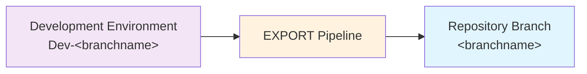

# Exporting Changes

The `EXPORT` pipeline for each repo takes the state of the solution(s) (and other assets like data if you include them) in your development environment, and exports them to the source control repo.

## Before You Export

- Save and publish the intended maker changes, and confirm the configured solutions contain all required components.
- Check the selected branch and its development Dataverse URL. EXPORT writes to that branch directly; it does not open a pull request.
- Coordinate with other makers using the same development environment. All configured solution changes are exported, not just the caller's changes.

> [!IMPORTANT]
> Ensure the automation identity can export solutions, update solution versions,
> and push to the branch. Branch protection may require an integration branch
> instead of exporting directly to `main`.
>
> Review data hooks before running them: exported records become repository
> contents and must not contain secrets or inappropriate personal data.

> [!TIP]
> Export frequently; there is no need to wait until you are ready to deploy. Each export
> captures your work in source control and creates a useful history.

Exporting takes all changes to the configured solutions (and other assets) from the
associated environment. There is no method to select individual changes, so coordinate
with other makers sharing that environment.

> [!NOTE]
> **Advanced: branch-specific development targets.**
>
> ALM4Dataverse uses a convention-based approach to associate each branch with a development environment:
>
> - **Azure DevOps**: looks for a service connection named `Dev-<Build.SourceBranchName>` (e.g. `Dev-main`). A branch such as `feature/customer-import` uses its last path component: `Dev-customer-import`.
> - **GitHub Actions**: uses the GitHub environment named `Dev-<branchname>` (e.g. `Dev-main`).
>
> GitHub uses the full branch name, so that same feature branch defaults to
> `Dev-feature/customer-import`. An explicit action `environment-name` can override
> credential resolution; update the job environment and OIDC credential consistently.
> See [branching strategies](branching-strategies.md).

## Run EXPORT

**Azure DevOps:**

1) Navigate to the **Pipelines** area of your AzDO project.
2) Select the **All** tab and navigate to the folder with the same name as your repo.
3) Select the `EXPORT` pipeline and click **Run pipeline**.
4) If you're using multiple branches, select the correct branch. Otherwise it defaults to `main`.
5) Enter the commit message.
   This is the message that will be logged in source control history. If you include ticket numbers in `#1234 #2345` format, the changes will also be shown against those tickets in the 'Development' section.
6) Click **Run**. The view will switch automatically to show progress. Wait until it is shown as successful.

**GitHub Actions:**

1) Navigate to the **Actions** tab of your repository.
2) Select the **EXPORT** workflow and click **Run workflow**.
3) If you're using multiple branches, select the correct branch. Otherwise it defaults to `main`.
4) Enter the commit message and click **Run workflow**.
5) Select the running workflow run to follow its progress. Wait until it is shown as successful (green checkmark).

## What Happens

1. Dependencies are installed and the application identity connects to the development environment.
2. `preExport` hooks run.
3. Each configured solution is exported to `solutions/<unique-name>`, including unpacked canvas-app content. Existing source is replaced by the export.
4. Solution changes are compared with the prior source; changed solutions reserve a unique version tag, then have their versions updated in both source and Dataverse.
5. `postExport` hooks run, including configured data exports.
6. All working-tree changes are committed with the supplied message and pushed. Azure DevOps uses the requesting user's name/email; GitHub uses the triggering actor and a GitHub noreply address.

No detected changes means no new commit. Data-only hook changes can create a commit without incrementing any solution version.

> [!NOTE]
> **Advanced: triggering BUILD.** On Azure DevOps the push triggers BUILD. On GitHub,
> EXPORT explicitly sends a repository-dispatch event after pushing, because a push made
> with `GITHUB_TOKEN` does not normally trigger another push workflow. BUILD checks out
> the exact exported commit; the BUILD caller must exist on the default branch.

### Version Increments

EXPORT increments changed solution versions according to the branch's configured
base and detected change type. During deployment, matching solution Major.Minor
versions permit updates; a different Major.Minor can require an upgrade.

> [!NOTE]
> **Advanced: version calculation and reservations.** The branch's configured
> `buildVersion` MAJOR.MINOR sets the solution's `Major.Build` base. The solution
> version format is `Major.Minor.Build.Revision`; `Minor` remains the
> non-additive upgrade counter used by DEPLOY. If an exported solution's
> `Major.Build` differs from the branch base, EXPORT resets its minor and
> revision counters before applying the current change's increment.
>
> | Detected solution change | Version effect | Example |
> | --- | --- | --- |
> | Additive change (or first export) with matching `Major.Build` | Increment revision | With base `2.3`, `2.4.3.7` becomes `2.4.3.8` |
> | Non-additive change with matching `Major.Build` | Increment minor and reset revision | With base `2.3`, `2.4.3.7` becomes `2.5.3.0` |
> | Additive change with mismatched `Major.Build` | Reset minor/revision, then increment revision | With base `2.3`, `1.9.8.9` becomes `2.0.3.1` |
> | Non-additive change with mismatched `Major.Build` | Reset minor/revision, then increment minor | With base `2.3`, `1.9.8.9` becomes `2.1.3.0` |
> | No source changes | No increment | Version remains unchanged |
>
> Changed solutions reserve their four-part version using a lightweight Git
> tag named `alm4dv/solution-version/<solution-unique-name>/<version>` (for
> example, `alm4dv/solution-version/Example/2.4.3.8`). The reservation tag is
> pushed to `origin` before the version is written to the exported solution.
> If another branch already reserved that version, EXPORT applies the same
> change-type increment again and retries. The push is the atomic claim, so
> simultaneous exports cannot both reserve the same version.
>
> Reservation tags are not release tags and do not trigger BUILD workflows.
> They are not removed when a later export step fails; this leaves a gap rather
> than allowing another branch to reuse the version. Do not delete or
> force-update these tags. GitHub EXPORT needs `contents: write`; the Azure
> DevOps build identity needs permission to create repository tags.
>
> When EXPORT runs on a non-default branch without a matching
> `buildVersion.branches` entry, it warns that `buildVersion.default` is being
> used. Configure an explicit branch base when that branch needs a different
> MAJOR.MINOR.
>
> Component comparison determines the change type, but does not guarantee that
> a business change is backward-compatible. The CI build/release identity is
> separate from each solution's version.

## Verify And Continue

Review the resulting commit for unintended solution/data changes, then check [BUILD](building-releases.md).

> [!WARNING]
> If the push fails because the branch advanced, do not force-push over others' changes.
> Coordinate the export/source changes, synchronize the development environment as
> appropriate, and rerun. EXPORT may already have updated Dataverse versions before a
> later Git failure. See [importing changes](importing-changes.md) for safe synchronization.

## Export Processing

Managed and unmanaged packages are exported in parallel by default, with up to
two package exports at once. Unpacking, change detection, and version updates
still run in the configured solution order. Pre-export and post-export hooks
keep their existing order and context.

Set `export.parallel = $false` in `alm-config.psd1` for sequential exports.
`export.maxParallel` controls simultaneous package exports;
`export.maxConcurrentOperations` limits package exports and environment version
updates together. Both limits accept integers from `1` to `8`. Custom hooks are
outside these limits. See [Export Processing settings](../config/alm-config.md#export-processing).

## Export Logs

Live messages identify the solution and phase, for example
`[MySolution][Export:Managed]`. Detailed package output is grouped by solution
and phase. Failures include the actual error in the standard log.

The final summary reports each solution's completed packages and elapsed export
time, including on failure. Export duration is elapsed time, not the sum of
concurrent package durations. Package counts and export durations are unavailable
in sequential mode.

Detailed logs, `summary.json`, and parallel package `timings.json` are retained
under `export-logs` in the artifact staging directory. Azure DevOps publishes
the `export-logs` artifact, and GitHub Actions uploads it even if export fails.
Local runs retain the same files.

For local measurements, `pipelines/scripts/export.ps1 -PassThru` returns
`Parallel`, `TotalSeconds`, and `WorkerTimings`. Authentication and dependency
installation are outside this measurement. This switch does not disable source
changes, environment version updates, or hooks.

## Viewing Exported Changes

**Azure DevOps:**

1) Navigate to **Repos** in Azure DevOps and select the correct repo and branch.
2) Switch to the **History** view.
3) Each commit is displayed with its message. Click a commit to see the full set of changes.

**GitHub:**

1) Navigate to your repository and select the correct branch.
2) Click **Commits** (shown above the file list).
3) Each commit is listed with its message. Click a commit to see the full diff.
