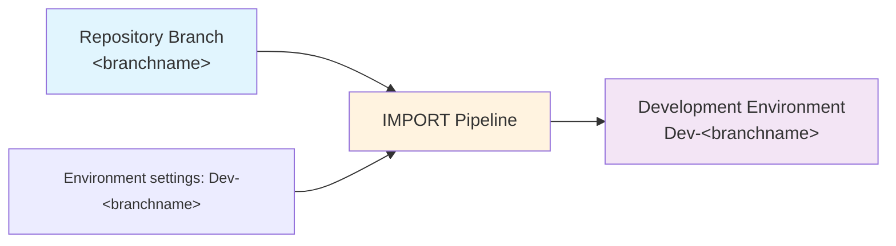

# Importing Changes

The `IMPORT` pipeline for each repo is used:

- When you have an empty development environment and you want to seed it from source control so you can start development.
- When you have an existing development environment and you want to update it with any changes from source control.

> [!IMPORTANT]
> IMPORT is for **development synchronization**, not promotion of a numbered release.
> It packs the selected source and imports unmanaged solutions. Use [DEPLOY](deploying.md)
> to promote a previously built package without rebuilding it.

## Before You Import

1. EXPORT any uncommitted maker work first. IMPORT is not a merge of target-only changes with source control.
2. Merge/rebase the desired upstream changes into the development branch and resolve conflicts in source control.
3. Confirm the branch's development target and its connection references, Dataverse values, and process-owner UPN.
4. Ensure external dependencies, connections, users, and required licenses exist in the target. IMPORT does not provision a Dataverse environment or those dependencies.
5. Inspect configured build/deployment hooks; they may modify data or organization settings.

> [!NOTE]
> **Advanced: branch-specific development targets.**
>
> ALM4Dataverse uses a convention-based approach to associate each branch with a development environment:
>
> - **Azure DevOps**: uses `Dev-<Build.SourceBranchName>`, the final branch path component. For `feature/customer-import`, this is `Dev-customer-import`.
> - **GitHub Actions**: uses the GitHub environment named `Dev-<branchname>` (e.g. `Dev-main`).
>
> GitHub uses the full branch name. See [branching strategies](branching-strategies.md)
> for the naming difference and the sequence EXPORT, integrate source, then IMPORT.

## Run IMPORT

**Azure DevOps:**

1) Navigate to the **Pipelines** area of your AzDO project.
2) Select the **All** tab and navigate to the folder with the same name as your repo.
3) Select the `IMPORT` pipeline and click **Run pipeline**.
4) If you're using multiple branches, select the correct branch. Otherwise it defaults to `main`.
5) Click **Run**. The view will switch automatically to show progress. Wait until it is shown as successful.

**GitHub Actions:**

1) Navigate to the **Actions** tab of your repository.
2) Select the **IMPORT** workflow and click **Run workflow**.
3) If you're using multiple branches, select the correct branch. Otherwise it defaults to `main`.
4) Click **Run workflow**. Select the running workflow run to follow its progress. Wait until it is shown as successful (green checkmark).

## What Happens

The script connects to the development target, runs the normal build process, then
deploys every solution with `UseUnmanagedSolutions`. That switch overrides individual
`deployUnmanaged` settings. Enabled checker rules and `preBuild`/`postBuild` hooks run,
followed by `preDeploy`, `dataMigrations`, and `postDeploy`. There are no separate
`preImport` or `postImport` hooks.

> [!NOTE]
> **Advanced: import behavior.** Unmanaged imports use `NoUpgrade` mode and do not set
> overwrite-unmanaged-customizations. They still use same-version skipping, so IMPORT
> does not force unchanged-version packages to reimport. It is not an environment reset
> or a mechanism to remove all obsolete unmanaged components. Any existing pending
> solution upgrades need particular care.

Target settings come from the [Azure DevOps development variable group](../config/azdo-environment-variable-group.md)
or [GitHub environment/prefixed configuration](../setup/github-variables.md). Secrets
must be explicitly mapped into the script/action environment.

IMPORT does not create a BUILD Release, change source versions, commit changes, or update
the successful deployment pointer used for baseline validation. It does publish
customizations and perform normal process ownership/activation.

## Verify The Result

Check the target environment's solution versions and import history, verify connections
and environment values, and confirm workflows/flows are active under the intended user.
Test the affected app behavior before resuming development. A successful pipeline does
not substitute for functional testing or prove an environment has been fully reset.
